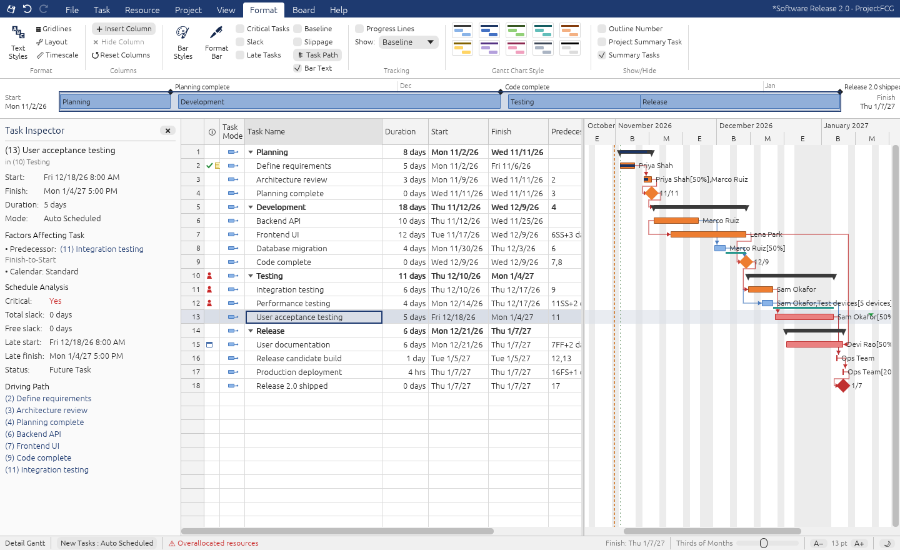
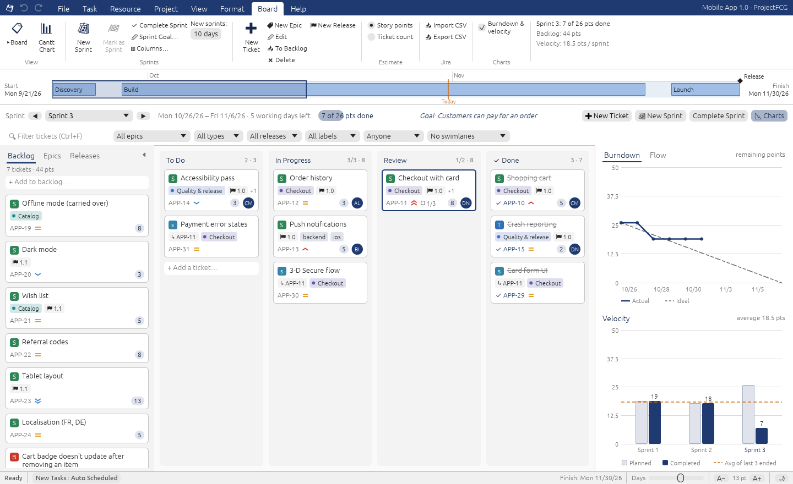
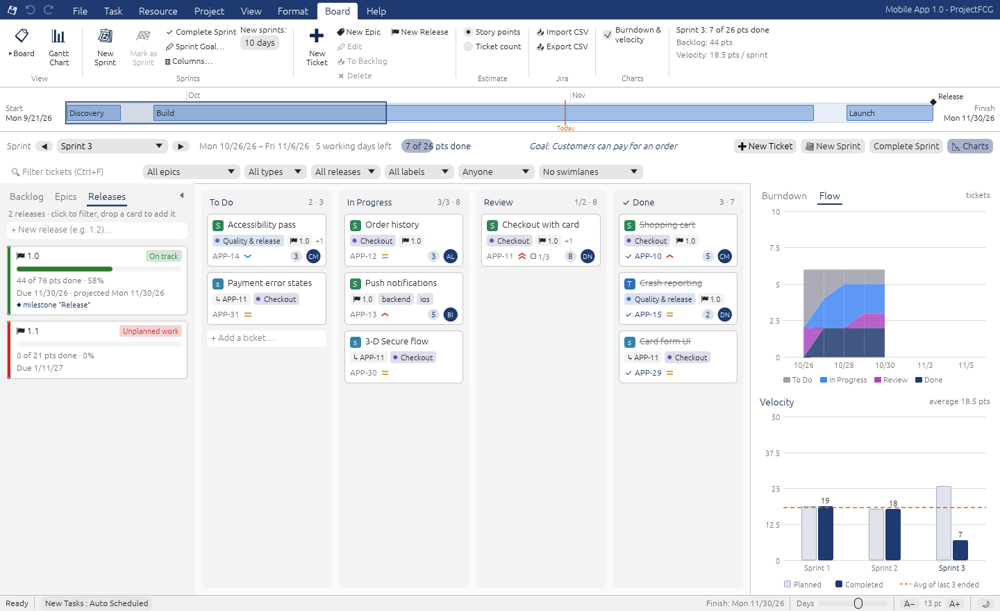
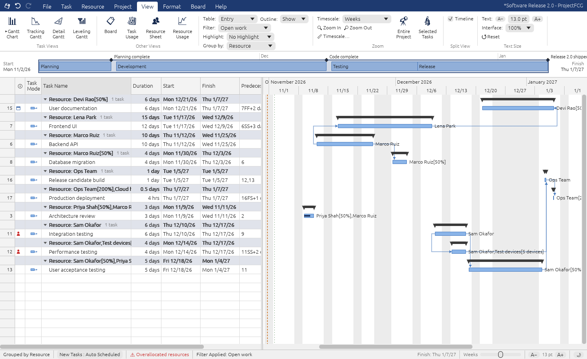
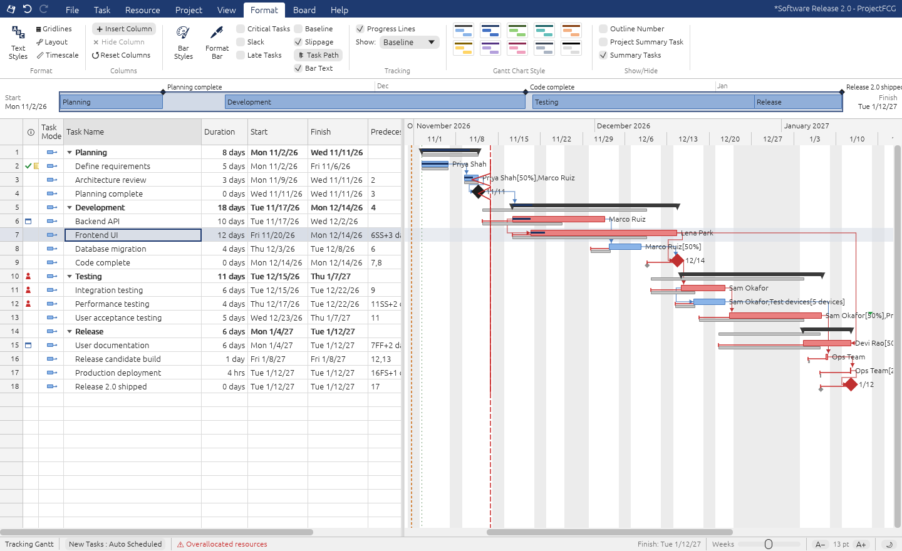
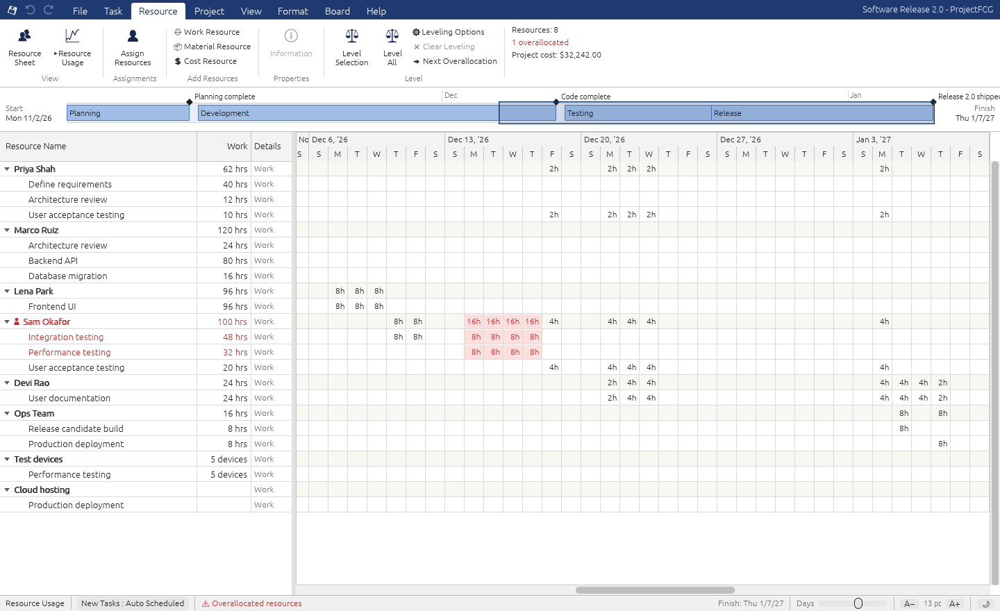
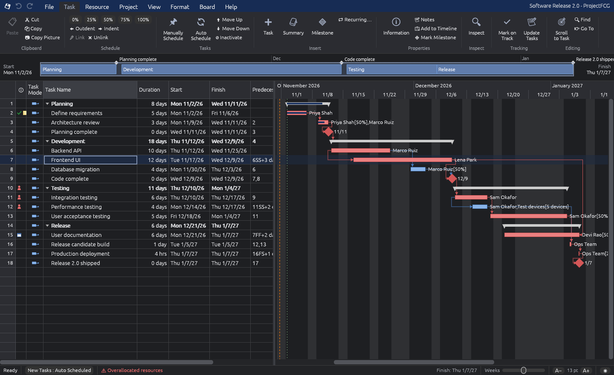
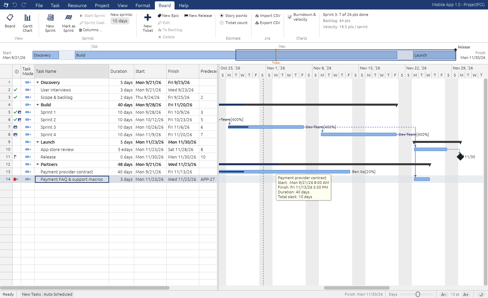

# ProjectFCG

A Gantt-chart project scheduler for Linux, written in Rust, whose scheduling
engine follows Microsoft Project's rules. Version 0.8.0 covers **core
scheduling** (0.1), **Gantt formatting, critical path analysis, baselines and
adjustable text size** (0.2), **resources, assignments, costs and leveling**
(0.3), **themes with dark mode** plus a performance pass (0.4), a
**Kanban board with sprints, a backlog, burndown and velocity** (0.5), and
**tracking with earned value, Jira-style epics and issue links, Jira CSV and
Microsoft Project XML import/export** (0.6), and **dependencies between the
board and the schedule, Jira's sprint lifecycle, swimlanes and WIP limits,
recurring and inactive tasks** (0.7), and **Group By and custom filters,
releases tied to the schedule, cumulative flow, slippage bars and Copy
Picture** (0.8).

*FCG* = Fast, Cheap, Good: pick two.

> **Renamed:** this app was *Gantry* (0.1–0.2) and *Ganttry* (0.3). It still
> opens `.gantry` and `.ganttry` files, and the first time it runs it picks up
> your preferences from `~/.config/ganttry/` or `~/.config/gantry/`. Project
> files are now saved as `.pfcg`, in a format older versions refuse to open.
> If you integrated an older AppImage with Gear Lever, remove that entry and
> add the new one.



| | |
|---|---|
|  |  |
| The Board: a sprint's tickets, the backlog, burndown and velocity | Releases (fix versions) and the cumulative flow chart |
|  |  |
| Group by Resource, with a custom filter | Tracking Gantt: baselines, slippage, a progress line at the status date |
|  |  |
| Resource Usage: hours per day, overallocations in red | Dark mode (follows the desktop, or View ▸ Theme) |

## Running on Bazzite

```sh
chmod +x ProjectFCG-x86_64.AppImage
./ProjectFCG-x86_64.AppImage            # blank project
./ProjectFCG-x86_64.AppImage --sample   # sample software-release schedule
./ProjectFCG-x86_64.AppImage --sample-agile   # sample with sprints, tickets and a backlog
./ProjectFCG-x86_64.AppImage plan.pfcg
./ProjectFCG-x86_64.AppImage plan.xml    # a Microsoft Project XML file (imported)
./ProjectFCG-x86_64.AppImage --self-test   # headless engine check, prints OK
```

* Bazzite ships **Gear Lever** for integrating AppImages into the app menu;
  that is the easiest way to "install" it.
* The AppImage uses the static type-2 runtime, so it does **not** need
  `libfuse2`. If FUSE is unavailable for any reason, run it with
  `--appimage-extract-and-run`.
* Runs natively on **Wayland** (KDE/GNOME) and on X11. The binary links only
  libc/libm/libgcc_s; X11, Wayland, EGL/OpenGL and xkbcommon are loaded from
  the host at runtime, so it uses Bazzite's own Mesa drivers. Requires
  glibc ≥ 2.39 for AppImages built on this machine; the ones GitHub builds
  (see *Releases*) need only glibc ≥ 2.35 (Ubuntu 22.04 and later).
* File dialogs use the XDG desktop portal (KDE/GNOME native dialogs). If no
  portal answers, a built-in dialog is used instead. Set `PROJECTFCG_NO_PORTAL=1`
  to force the built-in one.

## What's implemented

### Scheduling engine (`src/schedule.rs`, `src/calendar.rs`)
| Project feature | Status |
|---|---|
| Working-time calendars (Standard, 24 Hours, Night Shift), weekly pattern, exceptions/holidays | ✅ |
| Durations in min/hr/day/wk/mo, elapsed durations (`3ed`), estimated (`1 day?`), hours/day & hours/week options | ✅ |
| Links FS / SS / FF / SF with lag, lead, percent lag (`3FS+50%`) and elapsed lag | ✅ |
| Predecessor text notation (`2,3SS+1 day,4FF-2d`) | ✅ |
| Links to/from summary tasks (apply to all subtasks); invalid ones refused like Project | ✅ |
| Circular-link detection (refused with a message) | ✅ |
| Constraints ASAP, ALAP, SNET, SNLT, FNET, FNLT, MSO, MFO; "honor constraint dates" option | ✅ |
| Typing a Start/Finish on an auto task sets SNET/FNET (Project behaviour) | ✅ |
| Deadlines (green arrow, missed-deadline indicator, drives slack) | ✅ |
| Manually scheduled tasks (pinned dates; drive successors) | ✅ |
| Summary rollup (dates, duration, duration-weighted % complete) | ✅ |
| Critical path, total slack, free slack, early/late dates, negative slack | ✅ |
| Automatic calculation on/off (Ctrl+F9) and F9 recalculation | ✅ |

### User interface (`src/app/`)
* **Ribbon** with File / Task / Project / View / Format / Help tabs and a quick-access toolbar (Save, Undo, Redo).
* **Entry table**: ID, Indicators, Task Mode, Task Name, Duration, Start, Finish, Predecessors. 23 fields can be inserted (right-click a header, or Format ▸ Insert Column): Successors, % Complete, Total/Free Slack, Early/Late Start/Finish, Constraint Type/Date, Deadline, WBS, Unique ID, Critical, Milestone, Notes. Columns are resizable.
* Excel-style editing: type to replace, F2 to edit, Enter/Tab/arrows to commit and move, Esc to cancel. Date cells have a drop-down calendar; choice cells (Task Mode, Constraint Type, Milestone) have drop-down lists. Typing in the blank row adds a task.
* **Gantt chart**: two-tier timescale (Hours → Years, Project's nine presets plus continuous zoom), nonworking-time shading, today line, task/summary/milestone/manual bars, progress bars, critical-path colouring, slack bars, deadline markers, elbow-routed link lines for all four link types.
* **Mouse in the chart**: drag a bar to move it (sets SNET, as Project does), drag its right end to change duration, drag vertically onto another bar to create a Finish-to-Start link, double-click a bar for Task Information, double-click a link for Task Dependency. Hover tooltips show dates. Ctrl+wheel zooms; Shift+wheel scrolls horizontally.
* **Timeline** pane (View ▸ Timeline): project span, tasks marked "Display on Timeline", today, and the visible window. Click or drag it to pan.
* **Dialogs**: Task Information (General / Predecessors / Advanced / Notes), Project Information, Change Working Time (month view, exceptions, work weeks), Options, Task Dependency, Go To, Find, Keyboard Shortcuts (F1).
* Outline: indent/outdent, collapse/expand, outline levels, move up/down, Insert Summary Task, Insert Milestone, filters (Critical, Milestones, Summary, Incomplete, Completed), Project Summary Task row, outline numbers.
* Cut/copy/paste of tasks (links between pasted tasks are preserved; the system clipboard gets tab-separated text), Fill Down, multi-level undo/redo.
* Save/open `.pfcg` files (JSON, atomic writes), export CSV, "save changes?" prompt, drag-and-drop a file onto the window to open it.

### New in 0.2: Gantt formatting, critical path analysis, text size

**Text size & zoom** (View ▸ Text Size, or the A−/A+ buttons in the status bar)
* Table and chart text from 9 to 28 pt; rows, header, indents and column widths scale with it. Ctrl+Shift+> / Ctrl+Shift+< change it, Ctrl+0 resets.
* Separate whole-interface zoom (80–250%) for the ribbon and dialogs too (Ctrl+Alt+= / Ctrl+Alt+-).
* Both are remembered per user in `~/.config/projectfcg/prefs.json`.

**Colors and bar formatting** (Format tab, saved with the project)
* **Bar Styles** dialog with 11 categories: Task, Critical, Manual, Late, Milestone, Summary, Project Summary, Progress, Slack, Baseline, Deadline. Each has fill/border colour, pattern (solid, hatched, light, outline), height, start/end shapes (bracket, triangle, diamond, circle, arrow), and text on the left/right/top/bottom/inside of the bar, chosen from 15 fields.
* **Gantt Chart Style** gallery: 10 colour schemes in one click.
* **Format Bar**: colour individual tasks' bars (also in the right-click menu).
* **Text Styles**: colour and bold for all/critical/summary/milestone rows, and the highlight colour.
* **Gridlines**: Gantt rows, sheet rows/columns, top/bottom tier columns, current date, status date, project start/finish lines, with colours.
* **Layout**: link style (elbow / straight / hidden), 8 date formats, bar height, bar text on/off, short dates in bar text.
* **Timescale**: automatic, or 1–3 custom tiers (unit and count each); nonworking time behind or in front of bars, or hidden, in a chosen colour.

**Critical path analysis**
* Critical Tasks, Slack bars and Late Tasks switches. Late is measured at the status date, or today if there's none.
* **Multiple critical paths** (Project tab): each independent chain is critical against its own finish.
* **Task Path** (Format ▸ Task Path): highlight the selection's predecessors, *driving* predecessors, successors and *driven* successors in Project's orange/purple colours.
* **Task Inspector** (Task ▸ Inspect): what drives the selected task's start (which predecessor link, constraint, summary constraint, project start, manual dates or ALAP), its slack and late dates, the full driving path (click to jump), and one-click fixes: Respect Links, Auto Schedule, Clear Deadline.
* Columns: Start Slack, Finish Slack, Status (Complete / On Schedule / Late / Future Task).
* **Highlight** (View tab): shade rows matching a filter without hiding others. New filters: Late Tasks, Slipping Tasks.

**Views and baselines**
* View ▸ **Gantt Chart / Tracking Gantt / Detail Gantt**. Tracking shows actual bars over baseline bars with the critical path; Detail shows the critical path with slack bars.
* Project ▸ **Set / Clear Baseline** for the whole project or selected tasks (rolled up to summaries). Columns: Baseline Start/Finish/Duration, Start/Finish/Duration Variance.

### New in 0.3: resources and assignments

**Resources** (Resource tab ▸ Resource Sheet)
* Work, Material and Cost resources, with Initials, Group, Max Units, Std. Rate, Ovt. Rate, Cost/Use and Accrue At columns. The sheet is edited like the task table: type in the blank row to add a resource, Insert / Delete, F2, Shift+F2 for Resource Information.
* Rates are typed the way Project takes them: `$50/hr`, `400/d`, `2000/w`, `$120` per unit for material resources.
* **Resource calendars**: each resource inherits the project calendar and can add its own work week and exceptions (Resource Information ▸ Working Time). Vacations move that person's work and no one else's.
* Overallocated resources are shown in red with Project's red-person indicator, in the sheet and in the task table.

**Assignments**
* Type into the **Resource Names** column using Project's notation: `Alice, Bob[50%], Test devices[5 devices], Cloud hosting[$1,200]`. Unknown names are added as resources (File ▸ Options ▸ *Automatically add new resources*). A new resource's type is inferred from the notation: a labelled quantity (`[5 devices]`) makes a material resource and a money amount makes a cost resource. Options also sets the default task type, effort-driven default and currency symbol.
* **Assign Resources** window (Alt+F10), which stays open while you move between tasks like Project's: ✔ marks, Units, Cost, Assign / Remove, add a resource by name.
* Task Information ▸ **Resources** tab; task type, effort-driven and priority on the Advanced tab.
* **Work = Duration × Units**, with Project's three task types. *Fixed Units* (default): changing duration changes work. *Fixed Duration*: changing work changes units. *Fixed Work*: changing duration changes units. **Effort-driven**: adding a second person to a 4-day job makes it 2 days.
* Each assignment runs on its resource's calendar, and the task's duration is its longest assignment. If you give two people different amounts of work, the task finishes when the slower one does, and the shorter assignment ends early, as in Project.
* Columns: Resource Names, Resource Initials, Work, Cost, Fixed Cost, Type, Effort Driven, Priority, Leveling Delay, Overallocated. Bar labels can show resource names, initials, work or cost.

**Costs**
* Work hours × standard rate + cost per use; material quantity × rate; fixed amounts for cost resources; per-task fixed cost. These roll up through summary tasks to the project total, shown on the Resource tab.

**Usage views**
* **Resource Usage**: each resource with its assignments underneath, and work per day, week or month (follows the timescale). Overallocated periods are red.
* **Task Usage**: the same grid, grouped by task.

**Leveling** (Resource tab ▸ Level)
* **Level All / Level Selection** delay tasks until no resource is booked over its max units. **Clear Leveling** undoes it, and **Next Overallocation** jumps to the next conflict.
* Leveling Options: order (ID Only, Standard, Priority/Standard) and *level only within available slack*. Priority 1000 means "never delay this task", as in Project.
* The delay is a visible, editable **Leveling Delay** field, and the **Leveling Gantt** view (View tab) draws it as a bar in front of the task. The Task Inspector reports "delayed by leveling" as the start driver.
* Problems leveling can't fix are listed after it runs instead of being silently ignored: an assignment needing more units than the resource has, a delay larger than the slack when *within slack* is on, or a resource still overallocated.

### New in 0.4: themes, dark mode, speed

**Themes** (File ▸ Theme, the ☀/🌙 button in the status bar, or Ctrl+Shift+F11)
* Six accent colours: **Navy** (default), **Green** (Project's classic look), Teal, Purple, Burgundy, Graphite.
* **Light**, **Dark**, or **Use system setting** (the default). The system setting asks the desktop through the XDG portal, which KDE (including Bazzite) and GNOME support, and follows it live when you switch the desktop between light and dark. Without a portal it reads KDE's or GNOME's own settings, and failing that it uses light. `PROJECTFCG_SYSTEM_THEME=dark` overrides the detection.
* Every theme, in both modes, is tested against WCAG contrast targets: 4.5:1 for text and 3:1 for lines and bars.
* **Project files are theme-independent.** Bar, gridline and text-style colours stay as you chose them in the file. In dark mode they're adapted on screen only: a colour that would vanish against the dark chart, such as a black summary bar or the light grey gridlines, has its lightness mirrored while keeping its hue. Colours that already stand out (critical red, task blue) are untouched. Printing, sharing and light mode always see the original colours. The Bar Styles dialog says so in dark mode.

**Performance** (measured on generated projects; see `tests/perf.rs`)
| | 0.3 | 0.4 |
|---|---|---|
| Schedule 5,000 tasks | 140 ms | 26 ms |
| Edit + reschedule, 5,000 tasks | 160 ms | 38 ms |
| Level 2,000 tasks / 40 resources | 35 s | 0.23 s (3.7 s if the plan has ALAP tasks) |
| Level 5,000 tasks / 80 resources | too slow to measure | 0.56 s |
| Task Usage view, 5,000 tasks | 21 ms/frame | 2 ms/frame |

* Working-time arithmetic counts whole weeks at once instead of walking day by day, then corrects for holidays and vacations. It is checked against the day-by-day version on thousands of random calendars and intervals.
* Leveling places tasks in dependency order (a serial schedule-generation scheme). It then recomputes only the tasks a delay can affect, just before they're needed, instead of rescheduling the whole project after every delay. A test checks it gives *exactly* the same result as the slow way on 80 random projects.

**Fixes**
* Leveling: an SF or lead-linked successor that starts before its predecessor could be pushed back into a conflict after it was placed. A delay could be absorbed by a Start No Earlier Than constraint, or by a resource's day off, and leave the task where it was. On 40 random projects, leveling now leaves fewer resources overallocated with 6.5% less total delay.
* Moving with the arrow keys into a column off the right edge of the table now scrolls it into view.
* Assign Resources: the Units and Cost fields were too narrow to read.
* The default "today" line colour was too faint on white (2.6:1); new projects use a darker orange.

### New in 0.5: Kanban board

A hybrid of plan and board: **sprints are tasks on the Gantt chart, and tickets (stories) live on the Board**. A sprint is one bar on the schedule, a fixed timebox linked like any other task. Its tickets don't clutter the Gantt or get scheduled one by one.

* **Board tab** (or View ▸ Board). Pick a sprint (◀ ▶ or the list) and see its tickets in **To Do / In Progress / Review / Done**. The toolbar shows the sprint's dates, working days left, and points done.
* **Backlog** panel on the left: tickets not planned into any sprint. Drag a card into a column to plan it; drag it back to un-plan it. Collapse the panel with ⏴.
* **Cards** show the ID, story points and the assignee's initials. Drag them between columns, reorder within a column, or right-click to move to another sprint or the backlog. Double-click (or Enter) opens the ticket: title, story points (1·2·3·5·8·13 one click away), status, sprint, assignee, description.
* **Quick add**: type into "+ Add a ticket…" at the bottom of To Do (or at the top of the backlog) and press Enter.
* **Keyboard**: arrows select cards, Ctrl+←/→ moves a card between columns (Ctrl+→ from the backlog plans it into the sprint), Ctrl+↑/↓ reorders, Insert adds a ticket, Enter edits, Delete deletes. All of it is undoable.
* **Sprints**: Board ▸ **New Sprint** adds a Fixed Duration sprint (10 working days by default, configurable) after the last sprint, linked finish-to-start. Or mark any task as a sprint: Board ▸ Mark as Sprint, right-click ▸ Mark as Sprint, or Task Information ▸ Advanced. Sprints get a board icon in the Indicators column, with a tooltip summarising progress. Right-click ▸ Open on Board jumps to that sprint.
* **Estimate in story points or ticket count** (Board ▸ Estimate). The choice drives everything below.
* **Progress flows to the schedule**: a sprint's % complete is the share of its points (or tickets) in Done. It can't be typed over, and the sprint's dates don't move: scope flexes, the timebox doesn't. Tickets with no points are flagged in the toolbar.
* **Burndown** for the selected sprint: remaining points per working day against the ideal line, live for today.
* **Velocity**: planned and completed per sprint, plus the average of the last three sprints that have ended. The Board tab also shows that average, so you can size the next sprint against it.

### New in 0.6: tracking, epics, Jira and Project interchange

**Tracking and earned value** (Project's Task ▸ Tracking and Project ▸ Status groups)

* **Actual Start / Actual Finish / Actual Duration / Remaining Duration** columns, editable in the table. % complete stamps the actual start from the scheduled one, and 100% stamps the actual finish; an actual start pins the task, so links and constraints no longer move it.
* **Task ▸ Mark on Track** sets % complete to what the schedule expects at the status date. **Update Tasks** (Task ▸ 📝) edits % complete, actual and remaining duration, and actual dates together.
* **Project ▸ Update Project**: "update work as complete through" a date, either proportionally or 0%/100%, for all tasks or the selection, and optionally "reschedule uncompleted work to start after" it. **Status date** is in the Project tab.
* **Baselines 0–10** (Project ▸ Set Baseline shows when each was last saved), with work and cost. Format ▸ Show baseline picks which one the Gantt draws.
* **Progress lines** (Format ▸ Progress Lines): a line at the status date that bends left to each task's progress point. Peaks to the left are behind schedule.
* **Earned value** at the status date against Baseline 0: BCWS, BCWP, ACWP, SV, CV, SPI, CPI, BAC, EAC, VAC, TCPI, as columns (Insert Column ▸ Earned Value) and in **Project ▸ Statistics**.
* **Tables** (View ▸ Table): Entry, Schedule, Tracking, Cost, Work, Earned Value, Variance. Each switches the columns, as in Project.

**Epics, issue types and links** (Jira's model, on the Board)


* **Issue types**: Story, Task, Bug, Epic, Sub-task, with a coloured badge on each card. **Priority** (Highest…Lowest, Jira's chevrons), **labels**, and ticket **keys** ("APP-12") with a prefix per project.
* **Epics** group stories across sprints. The panel on the left has a second tab, **Epics**, listing each with a progress bar. Click one to show only its tickets, or drag a card onto it to add the card. **An epic can drive a Gantt task**: pick "Drives task" in the epic, and that task's % complete follows the epic's stories, the way a sprint follows its tickets. The plan shows feature progress without anyone typing a percentage.
* **Sub-tasks** split a story. They travel with their parent's sprint, show "↳ APP-11" on the card, and the parent shows "2/3" done. Add them from the ticket dialog or right-click ▸ Add Sub-task.
* **Links**: blocks / is blocked by, relates to, duplicates, clones. A card with an unfinished blocker gets a red edge and "Blocked". Blocking cycles are refused.
* **Filter bar**: text (Ctrl+F; matches summary, description, key and labels), epic, type, label, assignee. Esc clears it. New tickets join the epic you're filtering on.

**Jira CSV** (File ▸ Share, or Board ▸ Jira)

* **Import** a Jira export (Filters ▸ Export ▸ CSV, all fields). The columns read are Summary, Issue key/id, Issue Type (or *Work type*), Status, Priority, Assignee, Labels, Sprint, Story Points / Story point estimate, Parent, Epic Link, Description, Created, Resolved, and the issue-link columns. Issues are added to the current board, and Undo removes them. Missing sprints can be added to the schedule; missing assignees can be added as resources. Everything that didn't map is listed afterwards.
* **Export** the board as a CSV that Jira's importer reads (System ▸ External System Import ▸ CSV): parents before children, Parent as an issue id, repeated Labels and link columns.

**Microsoft Project XML (MSPDI)**

* **File ▸ Save as XML** writes a file Project desktop opens directly (File ▸ Open ▸ XML), as do ProjectLibre and anything built on MPXJ. **Open** reads `.xml` files: tasks and outline, durations (including elapsed and estimated), all link types with lag (time, elapsed and %), constraints, deadlines, manual tasks, notes, priorities, % complete and actuals, baselines 0–10, the project calendar with its exceptions (recurring ones are expanded), resources of all three types with their calendars, rates and accrual, and assignments.
* Microsoft retired Project Online on September 30, 2026. MSPDI is the vendor-neutral way to move a plan between desktop Project and other tools.
* After an import, ProjectFCG reschedules and says what didn't carry over, including how many tasks now start at a different time than in the file (task calendars, splits and work contours aren't supported yet).

**Faster**

* **Undo uses about 22× less memory**: history stores what changed, not a copy of the project. On a 5,000-task plan, 100 edits cost ~12 MB instead of ~320 MB.
* **Big boards**: a 12,000-ticket board draws in 7.5 ms (it took 38 ms when each card's ticket was looked up by scanning the list). Sprint and epic progress is computed in one pass when the plan reschedules.

### New in 0.7: the board and the schedule depend on each other

**Tasks that wait on stories (and epics)**

* A Gantt task can wait on a board item. Type its key in the Predecessors column (`3, APP-12, APP-27+2d`), or use Task Information ▸ Predecessors ▸ *Wait on board item*.
* Until the story is done, the task follows **the end of the sprint the story is planned in**, the team's commitment. It's a real finish-to-start link in the schedule: the sprint gains a successor, slack and the critical path run through it, and leveling moves the task when the sprint moves. Move the story to a later sprint and the task moves with it.
* Once the story is done, the task can start **when it was done**, which may be mid-sprint.
* Waiting on an **epic** means waiting on all its stories: the latest sprint holding unfinished ones, or the last done date.
* A story that isn't planned into any sprint has no date to wait for. It's reported (red indicator, tooltip, Task Inspector) rather than guessed.
* The Gantt draws these links dashed in purple, from the sprint bar. The Indicators column shows a card icon, filled while something is still open. Hovering a link names the story.

**Stories that wait on tasks**

* In the ticket dialog, *Waits on tasks* picks Gantt tasks that must finish first. The card shows "waits: Contract" and a red edge until the task is 100% complete.
* If its sprint starts before the task finishes, the card says **Planned too early**, as Jira Plans flags dependency conflicts. The same happens when a ticket is blocked by one planned in a later sprint. Right-click offers *Move to Sprint N (after what it waits on)*.
* The ticket dialog also lists the tasks waiting on the ticket, so both sides of a dependency are visible from either end.

**Jira's sprint lifecycle**

* **Start Sprint** records a sprint goal and the committed scope, with workload by assignee. **Complete Sprint** freezes the sprint's result and moves unfinished tickets, with their sub-tasks, to the next sprint or the backlog.
* Velocity now compares what was done with what was *committed*, so scope added mid-sprint, or work carried out at completion, no longer changes past sprints' bars. The goal shows in the board toolbar.
* **Columns…** (Board tab) renames, adds, removes and reorders columns and sets **WIP limits**. A column over its limit turns amber and shows "4/3".
* **Swimlanes** by epic or by assignee (filter bar).

**MS Project**

* **Recurring tasks** (Task ▸ Insert ▸ Recurring…): daily, weekly on chosen days, monthly or yearly, every N, ending after N occurrences or by a date. Like Project, the series is a summary whose occurrences are subtasks held at their dates. Task Information on the series edits the pattern.
* **Inactive tasks** (Task ▸ Inactivate, or right-click): for what-if planning. An inactive task stays in the plan, struck through with a hollow bar. It doesn't move its successors, doesn't roll into its summary's dates, work or cost, and books no resource time. Saved to and read from Project XML (`Active`).



### New in 0.8: groups, filters, releases

**Group By and filters** (View ▸ Data, as in Project)

* **Group by** Complete and Incomplete, Constraint Type, Critical, Duration, Milestones, Priority, Resource, Status or Active v. Inactive, or **by any field** (dates group by week). Each group gets a header row with its tasks' dates, duration, work, cost and % complete, and a summary bar on the Gantt. Click a header to collapse it. Grouping combines with any filter.
* **Custom filters** (Filter ▸ New Filter…): conditions on any field (*equals, is greater than, is within, contains* …) joined by And/Or, with *Show related summary rows*. Fields are compared by type: durations as durations ("is greater than 3w"), dates by day, money and % as numbers. Saved in the project file, undoable, and also usable as highlights.
* **Date Range…** (tasks under way between two days) and **Using Resource…** filters.
* On a 5,000-task plan a custom filter costs about 1 ms per redraw, and grouping on top of it about 3 ms.

**Releases (Jira's fix versions), tied to the schedule**

* Board ▸ **New Release**, or the **Releases** tab next to Backlog and Epics. Drop a card on a release to put it in, or pick one in the ticket dialog. Filter the board by release.
* Each release shows its progress and a **projected date**: the end of the latest sprint still holding unfinished stories. It's **At risk** when that's after the release date, and **Unplanned work** while some stories aren't in a sprint.
* **A release can stand behind a Gantt milestone** (Release ▸ Milestone, or *Add Milestone to Schedule*). The milestone waits on every unfinished story in the release, as a task waiting on an epic does, and the release date becomes its deadline, so the Gantt flags a release that won't make it. Link marketing, docs or deployment tasks to the milestone and they follow the release. The milestone gets a flag in the Indicators column with the release's status.
* **Release…** marks it released and moves unfinished stories to the next release (or out). Released releases take no new work.
* Jira CSV import and export carry **Fix Version/s**.

**Board**

* **Cumulative flow** (the Flow tab above the burndown): tickets in each column, day by day, from 0.8 on (each move is recorded). Earlier moves are inferred: To Do until the ticket was done.
* Over a weekend the sprint that ended on Friday stays the board's current sprint until it's completed or the next one starts, as Jira's active sprint does. (Before, the board jumped to the next sprint at 5 pm on Friday, and the agile sample completed the running sprint if opened at a weekend.)

**Gantt**

* **Slippage** (Format ▸ Slippage): a line from each task's baseline start to its start; red when it's later.
* **Copy Picture** (Task ▸ Clipboard): saves the view as it looks on screen as a PNG.

**Faster**

* Finding a top-level task's summary used to scan back to the first row, which made anything that walks the outline quadratic on big plans. Custom filters with *Show related summary rows* went from 18 ms to 2 ms per redraw on 5,000 tasks.

### Keyboard shortcuts (Microsoft Project's)
Insert (new task) · Delete / Ctrl+− (delete) · F2 (edit) · Shift+F2 (Task Information) · Ctrl+F2 / Ctrl+Shift+F2 (link / unlink) · Alt+Shift+→/← (indent/outdent) · Alt+Shift+↑/↓ (move) · Alt+Shift+− / = / Numpad* (hide / show / show all subtasks) · Ctrl+Shift+M / Ctrl+Alt+Shift+A (manual / auto) · Ctrl+Shift+F5 (scroll to task) · F5 (Go To) · Ctrl+F, Shift+F4 (find / next) · F9, Ctrl+F9 (calculate / auto-calc) · Ctrl+/ and Ctrl+* (zoom) · Alt+Home/End, Alt+←/→, Alt+PgUp/PgDn (timescale) · Ctrl+D (fill down) · Ctrl+Delete (reset field) · Ctrl+Shift+F11 (light/dark) · Ctrl+Z/Y, Ctrl+X/C/V, Ctrl+N/O/S, F12 · Alt+F10 (Assign Resources). The full list is under Help ▸ Keyboard Shortcuts or F1.

## Decisions I made (please review)

1. **GUI: egui/eframe with the OpenGL (glow) backend**, not wgpu. This halves compile time and gives the most predictable AppImage, because GL comes from the host's Mesa. Everything is drawn by the app, so it looks like Project rather than native KDE/GNOME.
2. **Themes are per user, not per file** (like text size), and **dark mode adapts the file's colours instead of storing a second set.** Two colour sets per file would drift apart, and someone receiving your file would see whatever you last picked. Adapting at draw time means one source of truth. Default theme: Navy, following the desktop's light/dark setting. (0.1–0.3 were light-only, in Project green.)
3. **Native file format is JSON (`.pfcg`)**, not `.mpp`. `.mpp` is an undocumented binary format; the only mature reader is MPXJ (Java). Interop with Project is through MSPDI XML (0.6), which Project opens directly.
4. **Lag is measured on the project calendar**, which is Project's default.
5. **Delete key**: deletes the task when the Task Name cell or whole row is selected. In other columns it resets the field, following Project's "Delete = clear selected data" with its task-name exception.
6. **Indenting a task under its own predecessor removes that link**, since Project forbids summary↔subtask links.
7. **SS/SF links from a summary task**, in the backward pass, only constrain the subtasks that drive the summary's start. Applying them to every subtask would make later subtasks falsely critical.
8. **Ctrl+F9 off** behaves like Project: edits update the outline and rollups, but task dates only move on F9. A "Calculate" link appears in the status bar.
9. **Dialogs close on Esc or Cancel only**, not on clicking outside them, as in Project. A dialog ignores the Enter/Esc that opened it, so an error caused by pressing Enter isn't dismissed by that same keypress.
10. **Task bars are labelled with resource names** as of 0.3, Project's default; 0.1–0.2 showed the task name because there were no resources. To get the old labels, use Format ▸ Bar Styles ▸ Text ▸ Right = Name. Project files saved by 0.2 keep their own bar styles.
11. **Formatting is saved in the project file; text size and interface zoom are per user.** This mirrors Project, which keeps view formatting in the .mpp, while text size is an accessibility setting that should follow the person, not the file.
12. **Critical / Slack / Late / Baseline switches and view changes are undoable** (Ctrl+Z), because they are part of the saved file. Task Path, Highlight and the Inspector are session-only.
13. **Text-size keys are Office's Ctrl+Shift+> / <.** egui's built-in Ctrl+Plus/Minus interface zoom is turned off because Ctrl+Minus is Project's "delete row" (in 0.1.0 both fired at once). Interface zoom uses Ctrl+Alt+= / -.
14. **"Late"** follows Project's Status field: complete is less than the schedule says it should be at the status date. Without a status date, today is used, as Project does.
15. **Task Path works at subtask level**, like the scheduler: a link to a summary task makes all its subtasks predecessors. "Driving" means the link that sets the start; a task held by a constraint has no driving predecessor.
16. **Eleven baselines** (0–10) since 0.6, as in Project. Earned value always measures against Baseline 0, which is Project's default "Baseline for Earned Value calculations".
17. **Resources can't be assigned to summary tasks.** Project allows it, but the summary's work then sits on top of its subtasks' work and makes rollups and usage hard to read. Assigning at subtask level gives the same totals without that.
18. **Leveling delay is stored in working minutes, measured from the task's early start** (after its links and Start/Finish No Earlier Than constraints, as Project defines the field), not as a date. It survives later edits, so leveling stays explainable: a task is always "N days after where it could otherwise start". No Later Than constraints still cap it when honoured. Project stores the delay in elapsed days. 0.3 applied the delay before constraints, so a constrained task could absorb it.
19. **The leveling heuristic is serial.** Tasks are taken in dependency order: a task is never placed before a task that can move it, and the leveling order (priority/ID/standard) breaks ties. Each is placed at the first slot where every resource it uses has room. This is not Project's exact algorithm, so leveled dates can differ from Project's on the same file. The *outcome rules* match: priority, do-not-level (1000), within-slack, no splitting.
20. **Flat work contours only, no overtime work.** Ovt. Rate is stored and shown but no work is booked as overtime. Accrue At is stored but costs are not yet time-phased, so it does not change any totals.
21. **Late dates use resource-calendar spans too**, so a task done by a half-time person has correspondingly less slack. (0.2 used the project calendar for everything.)
22. **Overallocation is judged per moment, not per day.** A resource is overallocated only if their booked units exceed max units at the same time, during their working time. Two 4-hour tasks on the same day, one in the morning and one in the afternoon, are not a conflict. This matches Project's red overallocation indicator. Project's leveling can additionally be set to look Day by Day or Week by Week, and ProjectFCG doesn't offer that setting.
23. **Renamed Gantry → Ganttry (0.3) → ProjectFCG (0.4)** at the user's request; old files and preferences carry over automatically (see top). Project files use **`.pfcg`**, because `.fcg` is already registered for FastCGI scripts, which web servers and file managers would treat as code.
24. **Plans with ALAP tasks level more slowly** (they fall back to full reschedules). An ALAP task's position depends on its successors, which breaks the one-direction recomputation the fast path relies on. They still level correctly.
25. **Board tickets are not tasks.** Microsoft Project's subscription desktop client also has Task/Sprint boards, but there every card *is* a Gantt task: a 40-story sprint becomes 40 scheduled rows, and the scheduler plans each story, which isn't how a sprint works. Here the sprint is the scheduled unit, and its tickets are planned inside it by the team.
26. **Ticket assignees are labels.** The team's workload comes from the resources assigned to the sprint task (the sample assigns a Dev Team at 400%). Booking ticket estimates on people as well would count the same hours twice. Assignees colour the cards and help you see who's on what; they don't affect usage, overallocation or leveling.
27. **Sprint % complete comes from the board, and sprint dates don't.** Points done ÷ points planned (or tickets, in count mode). If nothing in a sprint is estimated yet, the share of tickets done is used. A sprint with no tickets keeps the % complete you type. When the last ticket leaves a sprint (or the epic driving a task goes away), the % complete it was given resets to 0% instead of staying at a figure nothing supports.
28. **Velocity counts what's in Done now; burndown uses when each ticket reached Done.** "Planned" is the sprint's current scope, not a snapshot from sprint planning, so adding a ticket mid-sprint raises the planned bar and the burndown's starting point. Moving a ticket out of Done clears its done date. Summary tasks can't be sprints, and deleting or unmarking a sprint returns its tickets to the backlog.
29. **The Board tab opens the board.** Other ribbon tabs don't change the view (as in Office), but this one is a workspace: clicking it shows the board. Gantt Chart in the same tab, or View ▸ Gantt Chart, goes back.
30. **% complete is duration-based, and actual work and cost follow it.** This is Project's default ("updating task status updates resource status"). Resource costs accrue at start, end or prorated, from each resource's Accrue At setting. Fixed costs are prorated.
31. **Update Project only ever raises progress**, so work already reported is never lost. "Reschedule uncompleted work" gives *unstarted* tasks a Start No Earlier Than the date. Project would also split *started* tasks to move their remaining work; ProjectFCG has no splits yet, so started tasks stay where they are.
32. **EAC = ACWP + (BAC − BCWP) ÷ CPI**, the CPI-based forecast Project's EAC field uses. TCPI = (BAC − BCWP) ÷ (BAC − ACWP).
33. **Epics never sit in a sprint, and neither epics nor sub-tasks count** toward sprint totals, burndown, velocity or epic progress. These are Jira's rules: an epic's size is its stories', and a sub-task is part of its parent's estimate, so counting either would double-count. Sub-tasks always share their parent's sprint. Moving the parent moves them, and they can't be moved to another sprint on their own.
34. **An epic can drive a Gantt task, but not a sprint or a summary.** A sprint's progress already comes from its own tickets, and a summary rolls up. Several epics can drive the same task; their stories are pooled. Deleting the task unlinks the epic.
35. **Ticket links don't move dates.** Tickets aren't scheduled, so "blocks" is information shown on the card, not a dependency the scheduler enforces. Use task links on the Gantt for that. Blocking cycles are refused anyway, because they always mean a mistake.
36. **Jira import adds to the current board; it doesn't replace it.** Jira's issue numbers are kept when they're free and the key prefix matches, otherwise issues are renumbered and links and parents follow. Statuses map to columns by name first, then by meaning ("Closed" → Done, "In QA" → Review). Statuses with no match go to the first column and are listed. Labels are split on spaces, since Jira labels can't contain them. Without "add missing sprints", issues in unknown sprints go to the backlog.
37. **Saving as XML is an export, opening XML is an import.** The document stays a `.pfcg`. After opening an `.xml`, Save asks for a new name, so the XML isn't silently overwritten with data it can't hold. The board isn't written to XML; MSPDI has no place for it. The sprint tasks themselves are written as ordinary tasks.
38. **MSPDI units are Project's**, cross-checked by reading our files with MPXJ: currency in hundredths, rates per hour, lag in tenths of a minute (a % lag is the plain percentage), work and durations as ISO 8601. Elements are written in the schema's order, which Project validates on import. A test checks the order of every element against the schema's sequences.
39. **Recurring calendar exceptions are expanded into single days on import** (yearly, monthly, weekly, daily, by date or by "last Monday" style position). They're written back as individual dates, so a holiday series becomes a list of holidays in Project. ProjectFCG lets exceptions overlap (the later one wins); Project doesn't, so overlapping exceptions are resolved day by day and written as non-overlapping ranges. A derived calendar's exceptions take precedence over its base calendar's.
40. **A task waiting on an unfinished story follows the story's sprint, not a guess at the story's own date.** Tickets aren't scheduled inside their sprint (decision 25), so the sprint's end is the only date the plan commits to. It's pessimistic, but it can be explained in one sentence, and it gets earlier the moment the story is actually done.
41. **Board dependencies are finish-to-start only** (with a lag). "Start when the story starts" has no meaning for an unscheduled ticket.
42. **A ticket waiting on a task isn't enforced.** Moving a whole sprint later because one story waits would delay everyone's work, so the ticket is flagged instead, with a one-click fix. Jira Plans does the same with dependency conflicts.
43. **Loops through the board are refused when you type them** (the sprint already waits on the task). When one appears later because a story moved, it's ignored and reported on the task, rather than making the whole schedule circular.
44. **Project XML gets board dependencies as ordinary links** to the sprint task, so Project schedules the same dates. Dependencies on finished stories aren't written, since they're in the past. The board itself still isn't in the XML.
45. **Starting and completing sprints is optional.** Dates still decide which sprint is running. Start/Complete add Jira's commitment and frozen results for velocity. A sprint completed without being started commits its scope at that moment.
46. **Done is always the last column.** Removing a column moves its cards to the column before it. Adding a column after Done means cards that were done aren't any more (their done dates are cleared).
47. **Editing a recurring task rebuilds its occurrences**, so changes made to single occurrences are lost (Project warns the same way). An occurrence that falls on a day off moves to the next working day; Project asks.
48. **An inactive task still has dates**, from its own predecessors, so you can see where it would land. It just has no effect on anything else. Its own cost is shown but not totalled.
49. **Dragging a card between swimlanes only changes its column.** Assignees and epics are changed in the ticket, by the epic drop target, or from the card's menu, so a drag never reassigns work by accident.
50. **Grouped views list tasks without their outline, and leave out summary tasks** unless the filter picks nothing but summaries (Summary Tasks, say). A summary rolls up its own subtasks, so listing both double-counts; group totals only add up subtasks. Project can keep the outline inside groups ("Maintain hierarchy"); ProjectFCG doesn't.
51. **In custom filters "And" binds tighter than "Or"**: *A And B Or C* is *(A And B) Or C*, as in most query languages. Dates compare by day (time of day ignored), numbers as they're shown (so $0.30 equals 0.1 + 0.2), and "NA" matches an empty date. A value that doesn't parse for its field is refused when you save the filter.
52. **The current filter and group are per session, like the table; the custom filters themselves are saved in the file** (Project keeps both in the .mpp). Opening another file clears the highlight and the collapsed groups, which name the old file's things.
53. **Date Range shows tasks under way at any time in the range** (start ≤ to, finish ≥ from). Project's Date Range asks for tasks that start or finish in it; a task spanning the whole range would be missed that way.
54. **One release per story.** Jira allows several fix versions; the import keeps the first and lists the others. Epics and sub-tasks carry no release (an epic's size is its stories', and a sub-task ships with its parent).
55. **A release's projected date is its milestone's finish when it has one, else the latest sprint end with unfinished stories.** The milestone includes anything else linked before it (QA, app store review), so it's the better forecast. With unplanned stories there's no projection, since nothing says when they'll be done.
56. **The release date is copied to the milestone's Deadline when you set it** (and taken off when the release moves to another milestone or loses its date, if nobody changed it in between). Editing the deadline on the task doesn't change the release; edit the release.
57. **The flow chart counts the sprint's current tickets.** Tickets carried out of a sprint when it was completed don't appear in its past days. Recording sprint membership over time would fix that; it's not worth the file size yet.
58. **Copy Picture saves what's on screen** (Project's "For screen"), not the whole plan at print resolution. Full-plan image and PDF export is still on the roadmap.

## Not yet implemented (Roadmap)

| Milestone | Scope |
|---|---|
| ~~Agile~~ | Board, sprints, backlog, burndown, velocity (0.5); epics, issue types, sub-tasks, links, labels, filters, Jira CSV (0.6); board ↔ Gantt dependencies, sprint lifecycle, columns, WIP limits, swimlanes (0.7); releases, cumulative flow (0.8). Still open: Jira REST sync, control chart / cycle time |
| ~~Resources~~ | Done in 0.3. Still open: work contours, overtime, time-phased cost accrual, resource pools, Team Planner, generic/budget resources, leveling that splits tasks |
| ~~Interop~~ | MSPDI XML import/export done in 0.6. Still open: print/PDF export, `.mpp` reading, task calendars and splits in XML |
| ~~Tracking~~ | Done in 0.6; slippage bars in 0.8. Still open: physical % complete, actual work entered per assignment, time-phased actuals |
| Later | Full-plan image/PDF export and printing (0.8 saves the screen), drawings, task calendars, Network Diagram, Calendar view, Team Planner, custom fields/formulas, multi-level groups, AutoFilter on column headers, split tasks, schedule-from-finish projects, a high-contrast theme, fast leveling for plans with ALAP tasks |

## Building from source

```sh
cargo test                          # 315 tests: engine, analysis, resources, board, dependencies, tracking, epics/Jira, MS Project XML, recurring and inactive tasks, filters and groups, releases, invariants, UI (headless)
cargo test --release --test perf -- --ignored --nocapture   # timings on 500–5,000-task projects
cargo run --release -- --sample
./packaging/build-appimage.sh       # → dist/ProjectFCG-x86_64.AppImage
```
`build-appimage.sh` expects `appimagetool` and the static `runtime-x86_64` from
the AppImage project in `../tools` (or set `APPIMAGETOOL` / `APPIMAGE_RUNTIME`).

## Releases (GitHub Actions)

`.github/workflows/release.yml` builds all three platforms when a release is
published on GitHub, and attaches the files to it:

1. Bump `version` in `Cargo.toml`, commit and push.
2. **Releases ▸ Draft a new release**, create a tag such as `v0.7.0`, **Publish**.
3. The workflow runs the tests, then builds three files in parallel, each
   smoke-tested with `--self-test`:
   * `ProjectFCG-v0.7.0-linux-x86_64.AppImage`: built on Ubuntu 22.04, so it
     runs on any distribution from 2022 on.
   * `ProjectFCG-v0.7.0-windows-x86_64.exe`: a single file with the app icon.
     There's no installer and nothing to unpack.
   * `ProjectFCG-v0.7.0-macos-universal.dmg`: one app for Apple Silicon and
     Intel Macs, macOS 11 or later. Drag it to Applications.

If a build fails, fix it and run **Actions ▸ Release builds ▸ Run workflow**
with the same tag; files already on the release are replaced. A tag that
doesn't match `Cargo.toml` gets a warning, because the app reports the
Cargo version.

**Unsigned builds.** The Windows and Mac files aren't code-signed, which costs
money: a Windows code-signing certificate, and Apple's $99/year Developer ID
plus notarization. What that means for whoever downloads them:

* Windows SmartScreen says "Windows protected your PC". Click **More info ▸ Run anyway**.
* macOS says it "can't be opened because Apple cannot check it for malicious
  software". On macOS 15, open **System Settings ▸ Privacy & Security** and
  click **Open Anyway** (on older versions, right-click the app and choose
  **Open**). Or run `xattr -dr com.apple.quarantine /Applications/ProjectFCG.app`.

Both can be signed later by adding certificate secrets and a signing step to
the workflow.

**On Windows and macOS:** preferences are kept in `%APPDATA%\ProjectFCG`
and `~/Library/Application Support/ProjectFCG`, and light/dark follows the
system setting. Shortcuts written as Ctrl in this README are Cmd on a Mac.
Double-clicking a `.pfcg` file doesn't open it there yet; use File ▸ Open.

## Tests

* `src/*` unit tests (49): CSV parsing (quotes, embedded newlines, BOM, `;` files), Jira dates and headers, ISO 8601 durations, MSPDI duration/lag format codes and day types, calendar arithmetic (including fast paths checked against a day-by-day reference), duration/lag parsing and formatting, date parsing, shortcut map, timescale presets, working-time parsing, sample project, theme contrast (every accent × mode against WCAG targets), dark-mode colour adaptation, desktop theme detection replies, preference migration.
* `tests/invariants.rs`: 11 seeded randomized tests (the newest: 120 random projects with sprints, stories, board dependencies with % and day lags and inactive tasks, where the fast leveler must equal the reference, scheduling must be idempotent, and every task must start after the sprint it waits on) on generated projects (up to 200 tasks, all link types, lags, constraints, manual tasks, vacations, mixed task types). They check that links are honoured, slack matches critical, summaries roll up dates, work and cost, Work = Units × span, saving and loading is exact, scheduling is idempotent, 25 random edits undo and redo exactly, the fast leveler equals the reference on 80 projects (including selection-only leveling), and leveling clears every overallocation that is possible to clear.
* `tests/scheduling.rs`: 46 behaviour tests whose expected dates were derived by hand from Project's rules (Standard calendar, project start Mon 1/5/2026). They cover all link types, lags and leads, constraints and conflicts, ALAP, deadlines, holidays, elapsed time, manual tasks, summaries, slack, editing operations, undo, file round-trip, and a 2,000-task performance check.
* `tests/analysis.rs`: 12 tests for start drivers, multiple critical paths, start/finish slack, Task Path sets (including through summary links), Status/Late rollups, baselines, and loading 0.1.0 files.
* `tests/resources.rs`: 23 tests for task types, effort-driven, Resource Names notation, resource calendars, costs, overallocation, usage, leveling (order, priority, within-slack, chains, selection), file round-trip, and 300 tasks leveled in under a second.
* `tests/views.rs`: 14 tests: custom filters comparing durations, dates, money and text by type, And/Or precedence, Within, related summary rows, Date Range and Using Resource, Group By (built-in and by field, rollups, collapsing, with filters), saving, undo and validation, and the 0.8 review's findings.
* `tests/releases.rs`: 10 tests: progress, projection and risk as stories move between sprints, what can carry a release, a milestone following its release (and the tasks linked to it), loops reported, releasing with carry-over, repairing files, Fix Version/s in Jira CSV, and the 0.8 review's findings.
* `tests/board.rs`: 17 tests (including the sample's current sprint on every day of the week, and cumulative flow from recorded moves): starting and completing sprints (commitment, carry-over with sub-tasks, frozen velocity, reopening), editing columns (remapping, Done follows the last column); new sprints, ticket moves and ordering, done stamping, progress by points and by count, unestimated fallback, unmarking and deleting sprints, burndown, velocity and its average, assignees booking no work, file round-trip and loading 0.4 files, and the agile sample pinned to a fixed date.
* `tests/tracking.rs`: 13 tests: % complete stamping actuals, an actual start pinning the task, actual finish, actual/remaining duration, Update Project through a date, Mark on Track at the status date, earned value worked by hand and rolled up, the three accrual rules, baselines 0–10, leveling leaving started tasks alone, progress-line points, and saving tracking data while loading 0.5 baselines.
* `tests/epics.rs`: 14 tests: 60 seeded random sequences of board operations (add, move, retype, re-parent, link, unlink, delete, epic→task), checking after every step that the hierarchy rules hold and that undo/redo is exact, then a Jira export → import of the result; repairing hand-edited boards on load; epics outside sprints and their progress, sub-tasks following their parent and counting nothing, cascading deletes, links in both directions with cycle and duplicate checks, an epic driving a Gantt task, keys, and Jira CSV import (a realistic export with repeated Labels/Sprint columns, links and sub-tasks), sprint creation in natural order, renumbering on clashes, and a full export → import round trip.
* `tests/mspdi.rs`: 10 tests: 4,500 randomly damaged XML files (bad numbers, dates, durations, truncation) and 200 damaged Jira CSVs, none of which may panic; a rich plan (all resource types, % and elapsed lags, manual task, baselines 0 and 3, progress, resource vacation) round-trips with identical dates, costs and assignments, and the second trip is byte-identical; units as Project writes them; **every element's order checked against the schema's sequences**; a Project-style file with the project summary task, yearly and "last Monday" recurring holidays, a cross-project link, a midnight shift and placeholder rows; and files written by a second MSPDI writer (MPXJ 16) from our samples.
* `tests/dependencies.rs`: 12 tests: a task following its story's sprint (and moving with it), released at the done time, unplanned stories reported, epics, keys in the Predecessors text, loops refused or reported, stories waiting on tasks and planning conflicts, blockers planned later, deletes, files and undo, leveling, and the 0.7 review's findings.
* `tests/recurring.rs`: 5 tests: weekly series on chosen days, editing in place (links and extra tasks survive), holidays, month-end and yearly dates, daily series over weekends, refusals, files, undo and XML.
* `tests/inactive.rs`: 3 tests: no effect on successors, rollups, totals, resources or leveling; whole inactive phases; files and XML.
* `tests/ui.rs`: 76 end-to-end tests (new in 0.8: the Releases panel by mouse, collapsing group headers, Copy Picture's PNG) that drive the real app through egui's input pipeline (keystrokes, typing, clicks, double-clicks, bar and card drags) without a window. They include theme switching; every tab, view and dialog drawn in every theme; tracking tables and dialogs; real mouse drags of cards between columns, into and out of the backlog, onto an epic, and to a precise position; the filter bar; the ticket dialog with sub-tasks and links in one undo step; the Jira import dialog and export; Save as XML and opening XML; and a check that every symbol in the UI exists in the bundled fonts.
* A third independent review, of the 0.8 code, found 11 problems, among them: undoing a filter's deletion applied a different filter, Shift+arrow selected the wrong tasks in a grouped view, a release's old milestone kept its deadline, and the flow chart was empty for imported tickets. All are fixed and pinned by `review_*` tests in `tests/views.rs` and `tests/releases.rs`.
* Rendering the README screenshots turned up four more: the burndown's legend overlapped its axis, the status bar named a custom filter "Custom Filter", grouped views listed summary tasks under any filter, and over a weekend the flow chart never showed where tickets were.
* A second independent review, of the 0.7 scheduler, board and recurring/inactive code, found 18 more. Among them: typing a key followed by non-ASCII text could crash, a sprint could be held up by its own finished story, leveling miscounted inactive tasks and board loops, and editing a recurring task dropped links to its occurrences. All are fixed and pinned by `review_regressions_0_7_*` tests and the randomized leveler check.
* An independent review pass of the 0.6 import/export and board code found eight bugs (among them: Add Sub-task from a card failed, negated Jira statuses like "Not Done" landed in Done, derived MSPDI calendars lost to their base's exceptions, a sprint kept its % after its tickets left). All are fixed and pinned by `review_regressions_*` tests. The randomized board test caught a ninth (an epic could be retyped with itself as parent).
* The AppImage was also exercised by hand under X11 (Xvfb + xdotool) and Wayland (headless Weston).

## Layout

```
src/calendar.rs   working-time calendars & arithmetic
src/duration.rs   durations, lags, Project text formats
src/model.rs      tasks, links, constraints, project, date parsing
src/schedule.rs   CPM scheduler (forward/backward pass, slack, rollups, start drivers, status)
src/resources.rs  resources, assignments, task-type rules, costs, overallocation, usage
src/leveling.rs   resource leveling (dependency-ordered, lazy forward pass)
src/board.rs      Kanban tickets, issue types, epics, sub-tasks, links, sprints, progress, burndown, velocity, cumulative flow
src/releases.rs   releases (fix versions): progress, projection, milestones
src/views.rs      custom filter definitions (saved in the file)
src/recurring.rs  recurring task patterns and occurrences
src/tracking.rs   actuals, Update Project, Mark on Track, earned value
src/jira.rs       Jira CSV import/export (CSV parser, field mapping)
src/mspdi.rs      Microsoft Project XML (MSPDI) import/export
src/analysis.rs   task paths, critical tasks, baselines
src/format.rs     bar styles, text styles, gridlines, layout, timescale (saved in file)
src/ops.rs        editing operations (insert, indent, link, cell edits …)
src/history.rs    undo/redo
src/io.rs         .pfcg JSON and CSV export
src/app/          egui front end (ribbon, table, gantt, bars, timeline, inspector, dialogs,
                  resource sheet, usage views, resource dialogs, themes, system theme detection,
                  board view, tracking and import dialogs, filters and groups, release dialogs)
examples/xmldump.rs  writes the samples as MS Project XML (for checking with other tools)
examples/screens.rs  renders the README screenshots (`xvfb-run cargo run --release --example screens -- docs board`)
examples/profile.rs  profiling driver (callgrind: `cargo build --profile profiling --example profile`)
packaging/        icons (.png/.svg/.ico/.icns), desktop entry, AppRun, AppImage build script, macOS Info.plist
.github/workflows/release.yml  builds the AppImage, .exe and .dmg for each GitHub release
build.rs          embeds the icon in the Windows .exe
```

License: MIT.
