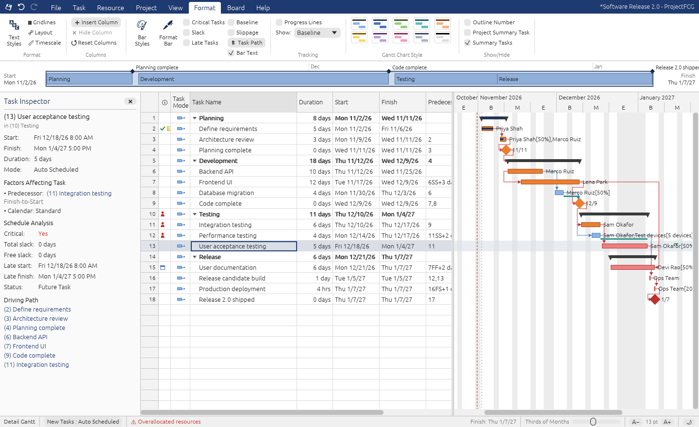
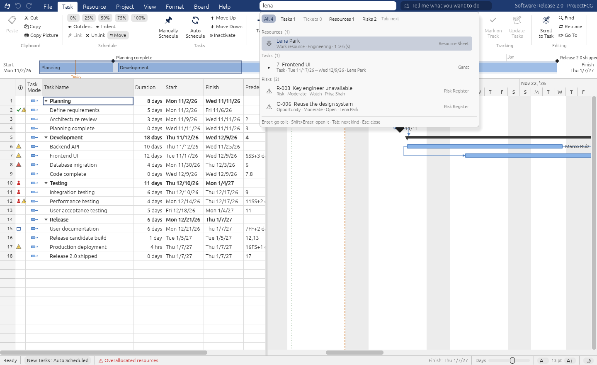
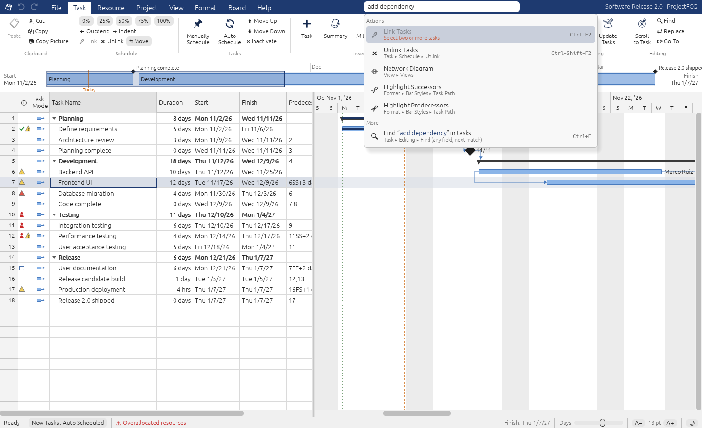
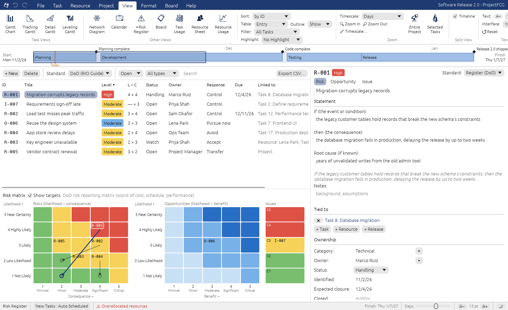
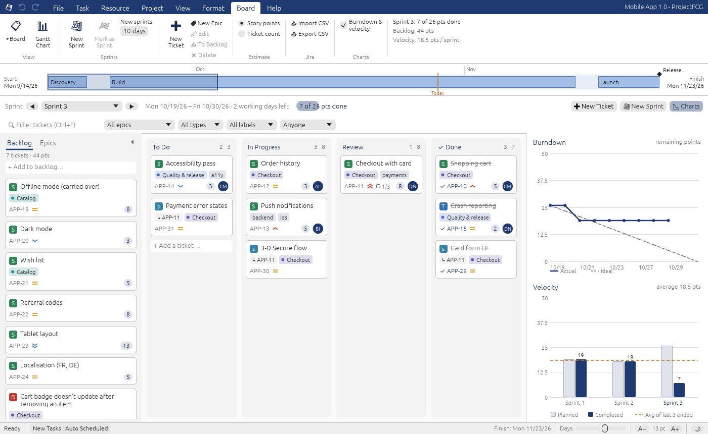
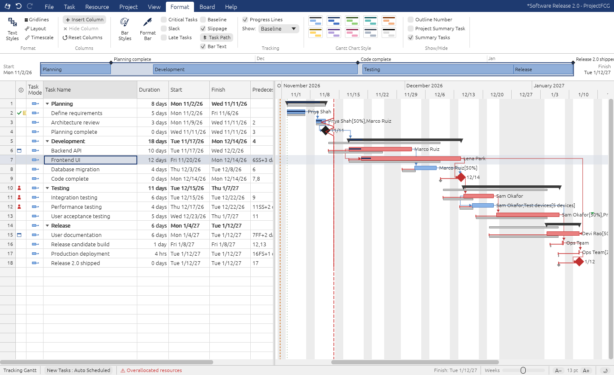
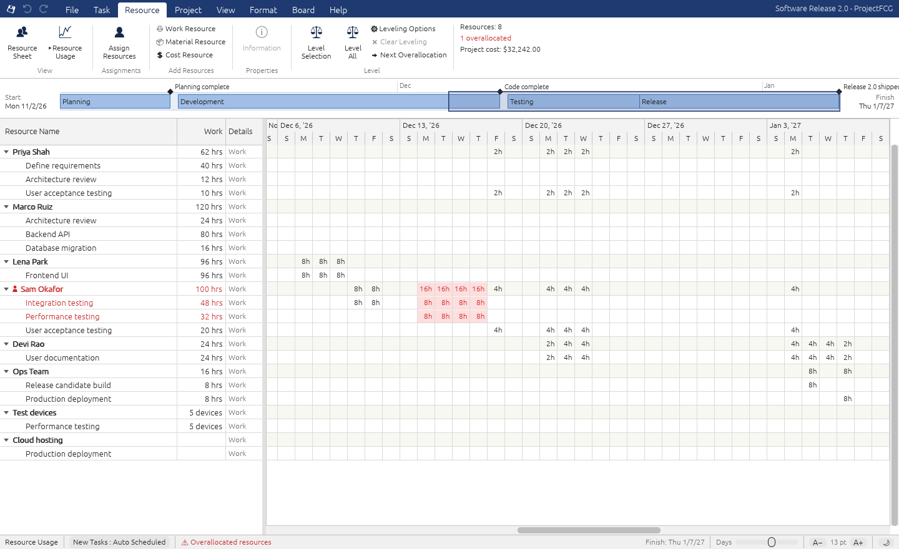
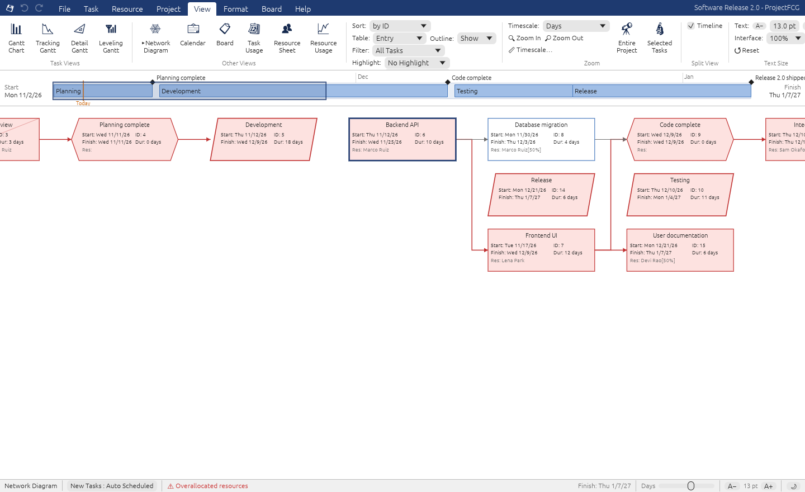

# ProjectFCG

A project scheduler for Linux, Windows, macOS and the browser whose scheduling engine follows Microsoft Project's rules. It also has a Jira-style board for teams that plan in sprints, and a risk register. It is free, open source (MIT) and saves to an open JSON format.

*FCG* stands for Fast, Cheap, Good: pick two.



> **About how it was made:** ProjectFCG was written with AI. The code is open, so you can read, test and audit it yourself. See [Built with AI](#built-with-ai) below.

## Install

Download the latest file for your system from the [Releases page](https://github.com/AnonyMap/ProjectFCG/releases).

**Linux (AppImage)**

- *With Gear Lever* (preinstalled on Bazzite): open the downloaded `ProjectFCG-…-linux-x86_64.AppImage` in Gear Lever. This adds ProjectFCG to the app menu, and *Check for updates* finds new versions by itself.
- *Without Gear Lever:*
  ```sh
  chmod +x ProjectFCG-*-linux-x86_64.AppImage
  ./ProjectFCG-*-linux-x86_64.AppImage
  ```
- **Requirements:** any distribution from 2022 or later (glibc 2.35+). It runs natively on Wayland and X11 and uses your system's graphics drivers. It doesn't need `libfuse2`; if FUSE isn't available, add `--appimage-extract-and-run`.

**Windows**

- Run `ProjectFCG-…-windows-x86_64.exe`. It's a single file with nothing to install.
- The file isn't code-signed, so SmartScreen will warn you. Choose **More info ▸ Run anyway**.

**macOS**

- Open `ProjectFCG-…-macos-universal.dmg` and drag the app to Applications. It runs on Apple Silicon and Intel, macOS 11 or later.
- It isn't notarized, so the first time you open it, go to **System Settings ▸ Privacy & Security ▸ Open Anyway**.

**In a browser, with nothing to install**

- Download `ProjectFCG-…-web.html` and double-click it. It opens in Chrome or Edge straight from disk, with no web server and no internet connection. It's the whole app in one 5 MB file, so it works where installing software isn't allowed.
- **Saving works as on the desktop.** Ctrl+S writes back to the file you opened (Chrome asks once per file for permission to save to it). Unsaved work is kept in the browser and offered back if the tab closes, and closing the tab with unsaved changes asks first.
- **What's different:**
  - Ctrl+N, Ctrl+W and Ctrl+T belong to the browser, so use File ▸ New.
  - Very large plans pause the page while they level.
  - In Firefox and Safari, Save downloads a copy instead of updating the file.
- More detail is in [web/README.md](web/README.md).

**From source**

```sh
cargo run --release -- --sample
```

You need Rust. Building, testing and packaging are covered in [docs/DEVELOPMENT.md](docs/DEVELOPMENT.md).

**Command-line options**

| Option | What it does |
|---|---|
| `ProjectFCG plan.pfcg` | Open a plan |
| `ProjectFCG plan.xml` | Import a Microsoft Project XML file |
| `--sample` | Open a sample software-release schedule |
| `--sample-agile` | Open a sample with sprints, tickets and a backlog |
| `--self-test` | Check the scheduling engine without a window |

**Where it keeps things**

| What | Linux | Windows | macOS |
|---|---|---|---|
| Preferences | `~/.config/projectfcg/` | `%APPDATA%\ProjectFCG` | `~/Library/Application Support/ProjectFCG` |
| AutoRecover copies and crash reports | `~/.local/state/projectfcg/` | `%LOCALAPPDATA%\ProjectFCG` | `~/Library/Application Support/ProjectFCG` |

On macOS, read Ctrl as Cmd throughout this README.

> **Older versions:** the app was once called *Gantry* and then *Ganttry*. It still opens `.gantry` and `.ganttry` files and picks up their preferences.

## What it does

You describe the work: the tasks, how long each takes, what depends on what, and who does it. ProjectFCG works out the dates. It finds the critical path (the chain of tasks that sets the finish date), shows where people are overbooked, and keeps the plan up to date as work is reported against it.

It's built for people who know Microsoft Project, or who need its kind of plan, but don't have Project, use Linux, or want their plans in an open format. Plans travel to and from Project as Microsoft Project XML.

Its two additions to Project are:

- **A board for agile teams.** Sprints are bars on the Gantt chart, and the stories inside them live on a Kanban board. Schedule tasks can wait on stories, and stories can wait on tasks.
- **A risk register** that can follow the DoD or PMI rating rules, with a risk matrix.

## Features

### Scheduling (the engine follows Microsoft Project's rules)

- **Durations:** minutes to months, elapsed time (`3ed`) and estimates (`1 day?`).
- **Dependencies:** finish-to-start, start-to-start, finish-to-finish and start-to-finish, with lead, lag or a percentage lag (`3FS+50%`).
- **Constraints and deadlines:** Start No Earlier Than, Must Finish On and the others, plus deadlines.
- **Schedule from the start or from the finish:** start from a start date, or from a finish date that the plan works backward from.
- **Task modes:** auto-scheduled tasks are placed by the engine, and manually scheduled tasks are pinned where you put them.
- **Special tasks:** summary tasks, milestones, recurring tasks, and inactive tasks for what-if planning.
- **Working-time calendars:** for the project, for each resource and for individual tasks (24 Hours, Night Shift or your own), with holidays and exceptions.
- **Analysis:** critical path (one or several), total and free slack, negative slack when a date can't be met.
- **Explanations:** the **Task Inspector** says why a task starts when it does. *Task Path* highlights what drives the selected task.

### Search

The title bar has two search boxes, as Outlook does: one for what's in the plan, one for commands.

**Search the plan (Ctrl+E)** finds tasks, tickets, people and risks by name, ID, ticket key or anything written in them:

- **IDs and keys:** "7" or "#7" is task 7, "APP-12" a ticket, "R-003" a risk.
- **Text:** words in notes, ticket descriptions and labels, assignees and risk statements count too.
- **People:** a person's name finds them first, then their tasks, tickets and risks.
- **Results** are grouped by kind with counts, best match first. Click a kind, or press Tab, to see only that kind.
- **Enter goes to it:** the task in the Gantt Chart (opening its summary, and clearing a filter that hid it), the ticket on the Board in its sprint, the person in the Resource Sheet, the risk in the Risk Register.
- **Shift+Enter opens it:** Task Information, the ticket, Resource Information.

**Tell me what you want to do (Alt+Q)** finds commands:

- **Your own words:** type what you want to do; you don't need to know the command's name or which tab it's on.
- **What it finds:** every ribbon command, plus every view, table, filter, group, sort and timescale.
- **Forgiving matching:** each action carries other words people use for it ("remove" finds Delete, "dependency" finds Link, "holiday" finds Change Working Time). Plurals, small typos and whole sentences ("how do I add a milestone") work too.
- **Each result shows** where the command lives and its shortcut, so you learn the faster way. Settings show whether they're on, and actions that can't run yet are greyed with the reason.
- **Before you type,** it lists your recently used actions and a few suggestions. When no command matches, it offers to search the plan for your words instead.
- **Keyboard:** ↑/↓ and Enter pick a result, and Esc closes the list.





### Views

- **Gantt Chart, Tracking Gantt, Detail Gantt and Leveling Gantt**, with a Timeline above them.
- **Network Diagram** and **Calendar**.
- **Resource Sheet, Resource Usage and Task Usage**, with hours per day, week or month.
- **Board** (sprints, backlog, burndown, velocity, cumulative flow) and **Risk Register**.
- **Tables:** Entry, Schedule, Tracking, Cost, Work, Earned Value and Variance, plus more than 20 insertable columns and custom fields (Text, Number, Flag, Date and Cost).
- **Built-in and custom filters, Group By, Sort, highlights, Find and Replace.**
- **Formatting:** bar styles, text styles, gridlines, timescales and Gantt chart styles, saved with the plan.
- **Themes:** six colour themes, light and dark mode (following the desktop), and adjustable text size and zoom.

### Resources and cost

- **Resource types:** work (people), material and cost resources, with rates, cost per use and maximum units.
- **Assigning:** type `Ana, Ben[50%]` in the Resource Names column, or use the Assign Resources window.
- **Work = Duration × Units,** with Project's three task types (Fixed Units, Fixed Duration, Fixed Work) and effort-driven scheduling.
- **Overallocation and leveling:** overallocations show in red. **Leveling** delays tasks until nobody is overbooked; big plans level in the background, with Cancel.
- **Costs** from rates, quantities and fixed costs, rolled up to the project total.

### Tracking

- **Baselines:** 0–10, with slippage lines and progress lines.
- **Progress:** % complete, actual and remaining duration, and actual dates, with *Update Project* and *Mark on Track*.
- **Earned value at the status date:** SPI, CPI, EAC and the rest, plus physical % complete.

### Agile board

- **Tickets:** stories, tasks, bugs, epics and sub-tasks, with story points, priorities, labels and links.
- **Sprints:** start and complete them, with a goal and committed scope. Columns are editable and can have WIP limits, and the board can use swimlanes.
- **Progress feeds the schedule:** a sprint's % complete comes from its tickets, and an epic can drive a Gantt task's % complete.
- **Releases (fix versions):** each has a projected date and can stand behind a Gantt milestone.
- **Jira CSV:** import and export.

### Risk register

- **One register** for risks, opportunities and issues. Each can be tied to tasks, resources, releases or the whole project, and tasks with open risks show an indicator.
- **No standard, or the DoD or PMI rules.**
  - **DoD** (RIO Guide 2023): *If … then …* statements, consequence rated separately for cost, schedule and performance, Accept / Avoid / Transfer / Control handling, and a burn-down of the handling steps.
  - **PMI:** cause → risk → effect statements, probability × impact scores, response strategies, triggers, contingency and fallback plans.
- **A 5×5 risk matrix,** with an arrow from each risk to its target rating. Click a cell to filter the register.
- **Every risk has** an owner, status, dates, cost and schedule impact and EMV, and the register exports as CSV.



### Files and sharing

- **Native files:** `.pfcg`, which is readable JSON.
- **Microsoft Project XML** in and out. Project, ProjectLibre and other MPXJ-based tools open it.
- **Print or PDF:** the view as it is, on as many pages as it needs.
- **Copy Picture** of the view, and **CSV** export of the tasks or the risk register.
- **Reliability:** AutoRecover, saves that can't leave a half-written file, and recovery from internal errors without closing the window.

| | |
|---|---|
|  |  |
| The Board: a sprint's tickets, the backlog, burndown and velocity | Tracking Gantt: baselines, slippage and a progress line |
|  |  |
| Resource Usage: hours per day, overallocations in red | Network Diagram |

## How to use it

The idea that makes everything else make sense: **you don't type dates, you type facts, and the engine works out the dates.**

The facts are:

- how long each task takes;
- what each task waits for;
- who does it;
- what calendar they work.

Change a fact and every date that depends on it moves. Typing a date into an auto-scheduled task doesn't move it the way you might expect: it adds a *constraint* (Start No Earlier Than), as in Project. Use a link instead whenever there's a reason behind the date.

Start with `--sample` to see a finished plan, or **File ▸ New** for a blank one. A typical plan goes like this:

1. **Set the frame.**
   - **Project ▸ Project Information:** the start date, or a finish date to schedule backward from.
   - **Project ▸ Change Working Time:** working days, hours and holidays.
2. **List the work.** Type tasks into the table with a duration each (`5d`, `2w`, `4h`, or `1 day?` for a guess).
   - Indent tasks (Alt+Shift+→) to group them under a **summary task**. A summary's dates come from its subtasks.
   - A task with a duration of `0d` is a **milestone**.
3. **Link the tasks.**
   - In the Predecessors column, type `3` (starts after task 3 finishes) or `3SS+2d` (starts 2 days after task 3 starts).
   - Or select tasks and press Ctrl+F2, or drag from one bar onto another.
4. **Read the schedule.**
   - **Format ▸ Critical Tasks** shows the tasks that set the finish date. Any delay to them delays the project.
   - **Slack** is how far a task can slip before it does.
   - **Task ▸ Inspect** explains any task's start date, and offers fixes.
5. **Add people.**
   - Add them in the **Resource Sheet**, then type their names in the Resource Names column.
   - Adding a second person to an effort-driven task shortens it. Someone booked on two things at once turns red.
   - **Resource ▸ Level All** delays work until nobody is overbooked.
6. **Save a baseline** (**Project ▸ Set Baseline**) once the plan is agreed. It's the yardstick that progress and slippage are measured against.
7. **Track progress.**
   - Set a status date, then enter % complete or actual dates (Task ▸ Update Tasks), or use **Project ▸ Update Project** for many tasks at once.
   - The **Tracking Gantt** shows actuals against the baseline, and the **Earned Value** table says whether you're ahead or behind on time and money.
8. **Share it.**
   - Save as `.pfcg`, or **File ▸ Save as XML** for someone using Microsoft Project.
   - **File ▸ Print** gives a PDF.

**Teams working in sprints:**

- Mark a task as a sprint (**Board ▸ New Sprint**), then plan stories into it on the **Board**.
- The sprint stays one bar on the schedule. Its tickets don't each become a row, and its % complete follows the stories that are done.
- A schedule task can wait on a story: type the story's key, such as `APP-12`, in Predecessors. It then follows the end of whichever sprint that story is in.

**Risks:**

- In **View ▸ Risk Register**, choose a standard (or none) and add risks.
- To tie a risk to a task, right-click the task ▸ *Add Risk for Task*.
- The matrix shows where risks sit and where their handling should take them.

**Can't find something?** **Ctrl+E** searches the plan, and **Alt+Q** finds a command from your own words.

Undo (Ctrl+Z) covers every edit. **F1** lists all keyboard shortcuts, which are Project's: Insert adds a task, F2 edits a cell, Shift+F2 opens Task Information, and F9 recalculates.

## Development

**Technology**

- Rust, with the [egui](https://github.com/emilk/egui) toolkit over OpenGL. It's one native binary with no runtime to install.
- About 37,000 lines of application code and 11,000 lines of tests.
- Its only libraries are for dates, JSON, XML, PNG, the window and file dialogs.
- **It makes no network connections.** The only other programs it ever starts are your desktop's theme setting reader (to follow light/dark mode) and your PDF viewer (to print).

**Structure.** The scheduling engine (`src/*.rs`) is a library with no user interface: calendars, the critical-path scheduler, resources and leveling, tracking, the board, risks, and file formats. The desktop app (`src/app/`) sits on top of it. That separation is what lets the tests drive the engine directly and the real interface without a window.

**How correctness is checked.** 433 automated tests run on every release:

- **Hand-derived expectations:** scheduling tests whose dates were worked out by hand from Project's rules.
- **Reference implementations:** the fast calendar arithmetic and the fast leveler are compared with slow, obviously-correct versions on thousands of random cases.
- **Randomized invariants:** links are honoured, slack matches the critical path, undo and redo are exact, and saving then loading changes nothing.
- **Interoperability:** Project XML is checked against the schema's element order and cross-checked by a second, independent XML reader (MPXJ).
- **Fuzzing:** thousands of damaged files, random edits and random clicks, in every view, must never crash or hang.
- **Headless UI tests:** the real interface is driven through keystrokes, clicks and drags.
- **Reviews:** since 0.6, every version has had a separate review pass over its new code, and every confirmed bug got its own regression test.

**Where it differs from Project.** Some choices were deliberate, such as JSON files instead of `.mpp` and the leveling heuristic. Each is recorded with its reasoning in [docs/DECISIONS.md](docs/DECISIONS.md).

Known gaps:

- no `.mpp` files (use XML);
- no split tasks, work contours or overtime;
- leveled dates can differ from Project's on the same plan;
- PDFs print only Western European characters;
- the Windows and macOS builds are unsigned.

**More detail:**

- [docs/CHANGELOG.md](docs/CHANGELOG.md): what each version added, and the bugs found along the way.
- [docs/DEVELOPMENT.md](docs/DEVELOPMENT.md): building, the release workflow, the full test inventory and the source layout.
- [docs/DECISIONS.md](docs/DECISIONS.md): every design decision and why.

Issues and pull requests are welcome. A crash report (in the `crash-reports` folder next to the AutoRecover copies) is the most useful thing to attach to a bug; it never contains your plan.

## Built with AI

ProjectFCG's code, tests and documentation were written by an AI model (Anthropic's Claude, working in Claude Code). A human maintainer directs it: they decide what gets built, try each release on their own machine, and choose what is merged and released.

What that means for you:

- **Everything is open.** All the source is in this repository under the MIT license. You can read it, build it yourself instead of trusting a download, and use or change it however you like.
- **The checks were automated, and largely AI-run too.** The test suite, the fuzzing and the code reviews described above catch a great deal, and every finding is pinned by a test you can run. But the reviews were also done by AI, so they are not a substitute for an independent human audit. If you rely on ProjectFCG for something that matters, verify its numbers against your own expectations, as you would with any new tool, and report anything that's off.
- **Your data stays yours.** Plans are plain JSON files on your disk, and the app makes no network connections. Both claims are easy to check in the source.

## License

MIT. See [LICENSE](LICENSE).
