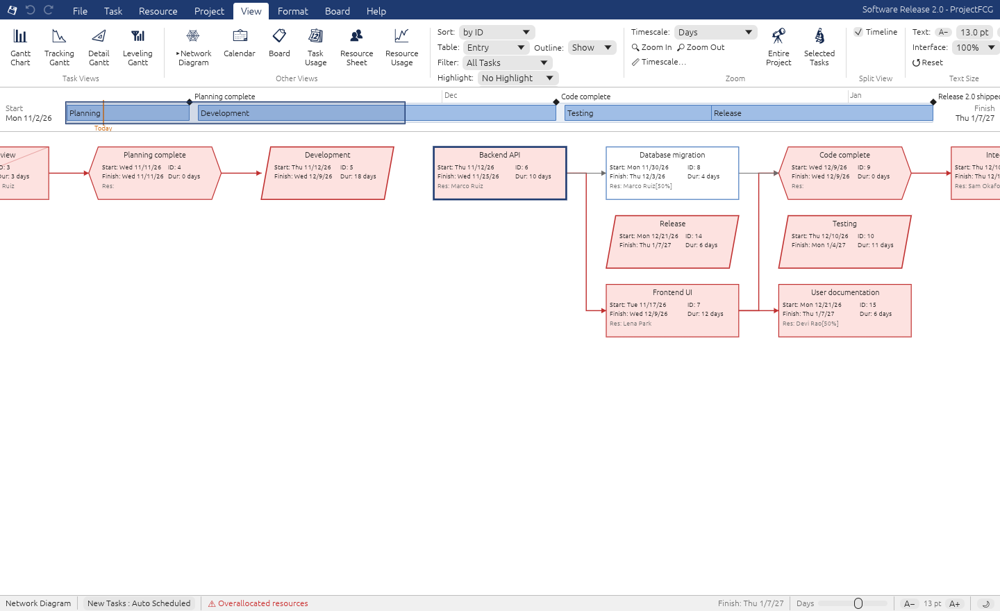
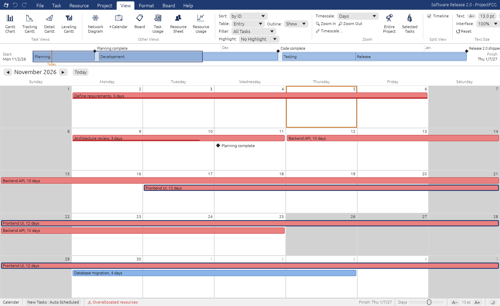
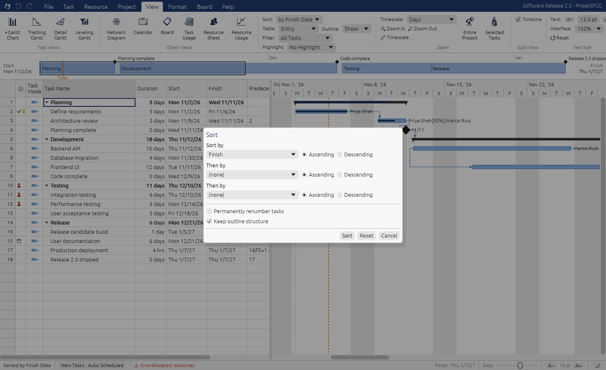
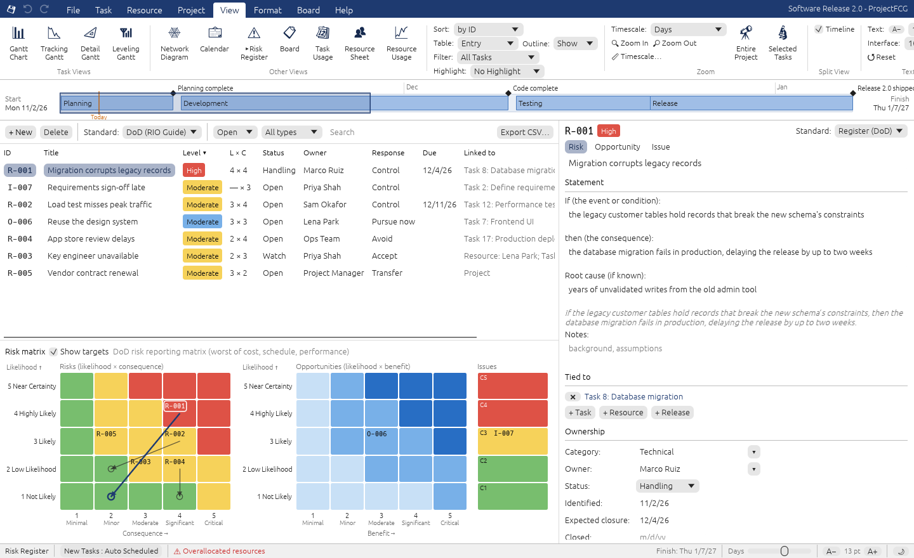
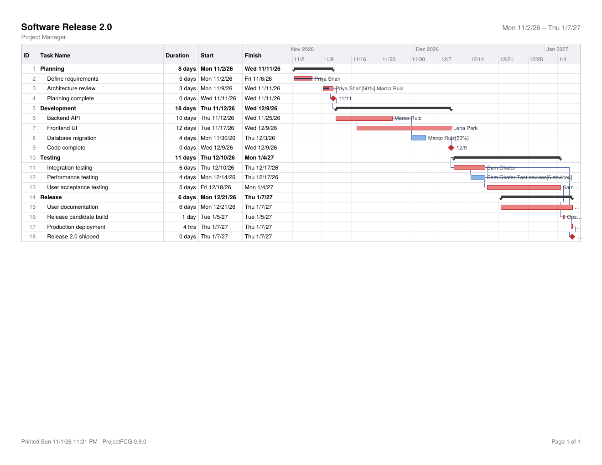
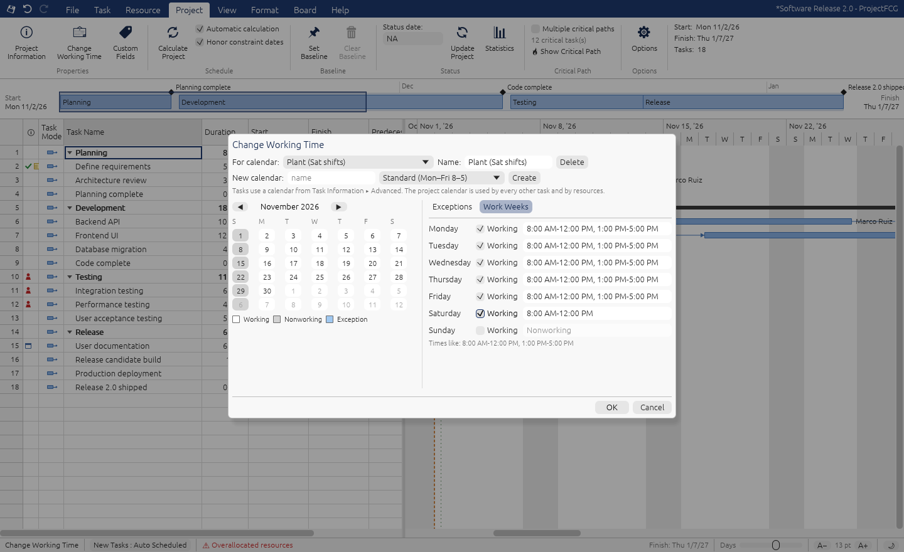
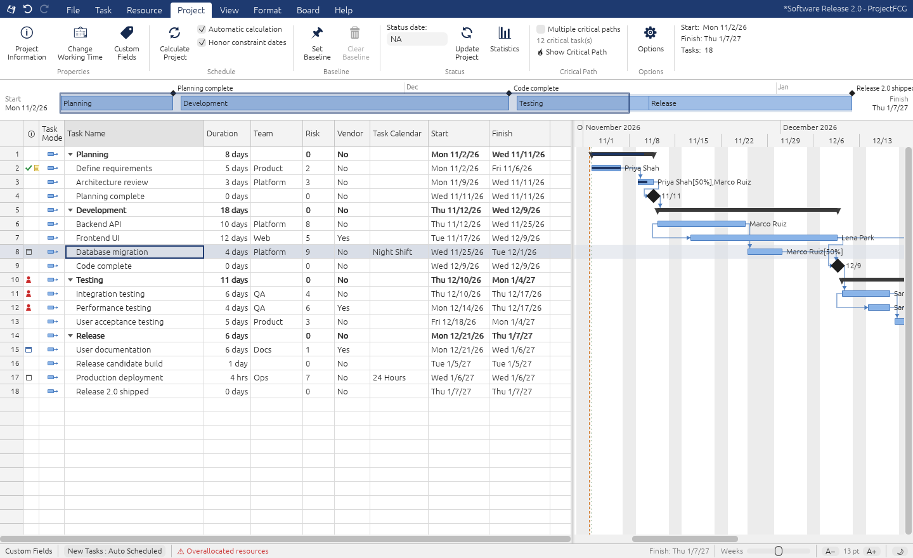
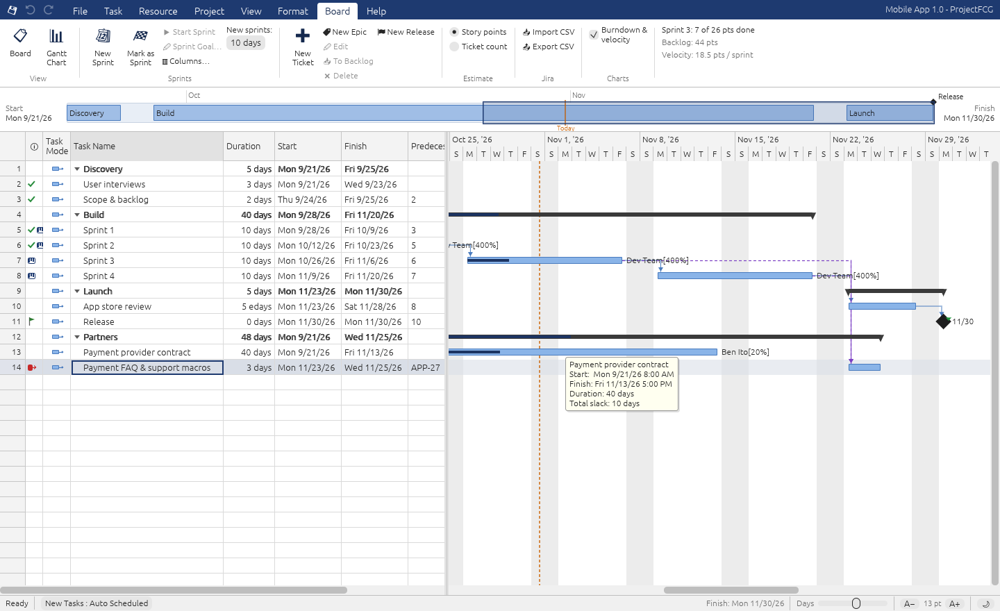
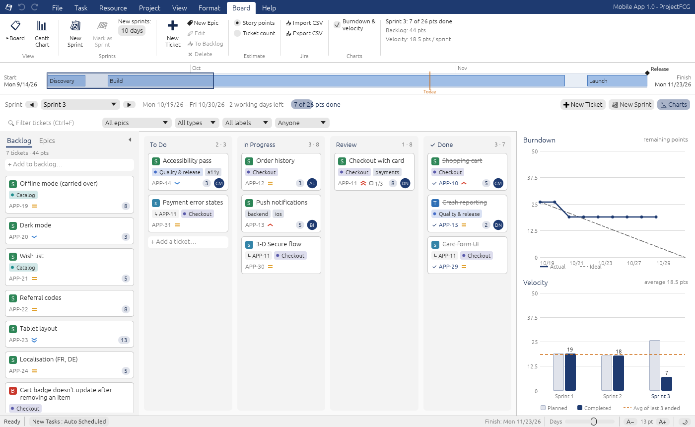

# Changelog

What each version added, newest first, with the bugs that reviews and fuzzing found along the way. The [README](../README.md) describes the app as it is now.

## 0.12: Search for what you want to do

- **Search box:** in the title bar, as in Outlook and Word, opened with **Alt+Q** or a click (`src/app/tell_me.rs`). Type what you want to do and pick the action.
- **What it covers:** about 220 actions, which is every ribbon command plus every view, table, filter, highlight, group, sort, timescale, outline level and theme.
- **Matching:**
  - Each action has other words people use for it.
  - Word prefixes, plurals and small typos match, and filler words ("how do I…") are ignored.
  - Generic verbs ("add", "set", "show") count only when they match.
  - Every other word typed has to match.
  - Recently used and everyday actions rank higher, except on a typo guess.
- **Each result shows** its ribbon location, its shortcut and whether a setting is on. Unavailable actions are greyed with the reason.
- **Before you type,** it shows recently used actions (kept in the preferences) and suggestions. Below the actions come tasks whose names match, and Find in tasks.
- **Tests:** a test reads `ribbon.rs` and fails if any ribbon button can't be found by Search, so new buttons have to be added to it.

## 0.11: ProjectFCG in a browser

**The web build**

- **One file:** the whole app compiles to WebAssembly and is packed into a single `ProjectFCG-…-web.html` (about 5 MB). It runs when double-clicked, from disk, in Chrome or Edge, with no server, install or network. The scheduling engine is the desktop one, so it computes the same dates.
- **Saving:**
  - In Chrome and Edge, Open and Save As use the system file dialogs, and Save writes back to the same file. Chrome swaps the file in only when the write is complete.
  - Elsewhere, Open uploads a file and Save downloads a copy.
  - AutoRecover keeps unsaved work in browser storage 10 seconds after a change and offers it back next time.
  - Closing a tab with unsaved changes asks first.
- **Everything else carries over:**
  - Print opens the PDF in a new tab.
  - Exports, Copy Picture and Jira and Project XML imports work, as do dropped files, the clipboard, preferences, and dark mode.
- **Keys:** the page claims Project's keys from the browser: F1–F10, F12, Ctrl+F/H/G/D/−/=/0 and Alt+arrows/Home/End.
- **Releases** now carry the web file next to the AppImage, .exe and .dmg.

**Tested in Chromium, from disk:**
- every view and dialog;
- typing, undo and redo;
- the clipboard;
- every export and import, Print and Copy Picture;
- drag and drop, the mouse (context menu, wheel, double-click, dragging bars) and preferences across reloads;
- a 2,000-task plan: it opens in about 0.2 s, runs at 60 fps, and AutoRecover keeps its 3.5 MB.

**Bugs the browser testing found, also on the desktop:**
- **Tab out of a cell, then typing, lost the typing.** egui moved its keyboard focus to another widget on Tab. The table now takes focus back. Shift+Tab saved the edit without moving back a column; it now moves.
- **Typing a value and Enter quickly** (or on a slow frame) opened the editor but gave Enter to the table. The selection moved and the value was never saved; a task name typed and tabbed out of was lost the same way. Keys that arrive in the same frame as the first character now go to the new editor. This applies in the task table and the Resource Sheet.
- **Web only:** Ctrl+X/C/V ran twice, once for the key and once for the browser's clipboard event. Paste inserted the rows twice, and Cut would have cut two things.

## 0.10: stability, Network Diagram, Calendar, sort, find and replace, schedule from finish, risk register

**Stability**

* **A bug no longer closes the window.** An edit that hits an internal error is undone and reported, and the plan stays as it was. A problem while drawing closes whatever dialog was open. If it happens again, ProjectFCG goes back to the last plan that drew cleanly. Either way it keeps running, and it says so in a notice.
* **AutoRecover** (File ▸ Options, every 5 minutes by default) copies unsaved work to `~/.local/state/projectfcg/recovery` from a background thread. If the window is killed, the computer loses power, or something does crash, the next start offers the copy back. It opens as a new plan, so saving it never overwrites anything without asking. A second ProjectFCG window that's still running is never mistaken for a crash.
* **Crash reports** go to `~/.local/state/projectfcg/crash-reports`. They hold what failed and where, never the plan's contents, and they're worth attaching to a GitHub issue.
* **Saving can't truncate a file.** Saves, exports and preferences are written to a temporary file, flushed to disk, then renamed over the old one.
* **Damaged files open.** An automated fuzzing campaign (thousands of mutated files, random edits and random clicks) found the crashes listed below. Every file opened now has its values pulled into range first: dates between 1900 and 2200, durations and lags within 100 years, finite numbers, unique IDs. A file whose numbers can't be right opens rather than crashing.
* **Large plans level in the background** with a progress bar and Cancel, so the window never stops responding. Plans with ALAP tasks also level 2–3× faster.

**New views** (View ▸ Network Diagram, Calendar)

* **Network Diagram**: each task is a box with its name, start, ID, finish, duration and resources, in columns by the order the work happens. Critical tasks are red. Finished tasks are crossed out and tasks under way half crossed. Milestones are hexagons, summaries parallelograms, manual tasks dashed. Drag to pan, Ctrl+scroll to zoom, double-click for Task Information.
* **Calendar**: a month of weeks with the tasks as bars across the days they run, wrapping from week to week, with "+N more" when a week is full. ◀ ▶ and the mouse wheel change month.

**Project's everyday tools**

* **Sort** (View ▸ Sort): by Start Date, Finish Date, Priority, Cost or ID, or *Sort By…* up to three fields, ascending or descending. The outline is kept, so subtasks sort under their summary, unless you untick that. *Permanently renumber tasks* reorders the plan itself. Sorting works inside groups too.
* **Find and Replace** (Ctrl+F, Ctrl+H): any field, any test (contains, equals, is greater than…), down or up, match case. They follow the current filter and sort and open collapsed summaries to show a match. **Replace All** is one undo step, and all or nothing: if one replacement is invalid, nothing changes. Replacing a name in Resource Names reassigns the work.
* **Move Task** (Task ▸ Move): forward or back 1 day, 1 week, 4 weeks or any number of working days. As in Project, auto-scheduled tasks get a *Start No Earlier Than* constraint, date constraints move with them, manual tasks just move, summaries move their subtasks, and started tasks stay put. Also *When Resources Are Available* and *Incomplete Parts to Status Date*.
* **Schedule from the project finish date** (Project Information): tasks are scheduled as late as possible so the project ends on that date, and the start is worked out. New tasks are As Late As Possible, and tasks that can't make the date show negative slack. Project XML files scheduled this way now import as such.
* **Physical % Complete** and **Earned Value Method** (per task, with a project default in Options): earned value can measure work done rather than time spent. They're in the Tracking table and in Project XML.

**Risk register** (View ▸ Risk Register)

Project itself has no risk register (teams keep one in a spreadsheet or in Project Online), so this one follows the two guides PMs are usually asked to report against, or neither:

* **Risks, opportunities and issues** in one register, each tied to **tasks, resources, releases, or the whole project**. Right-click a task ▸ *Add Risk for Task* starts one. Tasks with open risks show a ⚠ in the Indicators column, coloured by the worst level, and its tooltip lists them.
* **The standard is per register, and a risk can follow its own:**
  * **None**: a free description, likelihood and impact 1–5, Low/Medium/High by L × I, an optional probability in %.
  * **DoD** ([Risk, Issue, and Opportunity Management Guide, 2023](https://www.dau.edu/sites/default/files/2023-10/DoD%20RIO%20Guide%20Sep%202023.pdf)): an *If … then …* statement with a root cause; likelihood 1–5 (Not Likely >1–20% … Near Certainty >80–99%); consequence rated separately for **cost, schedule and performance**, with the guide's criteria as tooltips, where the worst counts. Handling is Accept / Avoid / Transfer / Control, or Pursue now / Defer / Reevaluate / Reject for opportunities. Issues have no likelihood and are rated on consequence alone. A **burn-down** charts the planned rating after each handling step against its date.
  * **PMI** (PMBOK / Practice Standard for Project Risk Management): a cause → risk → effect statement; probability 0.1–0.9 and impact 0.05–0.80 (cost, schedule, scope, quality), with **P × I scores** (High ≥ 0.18, Moderate ≥ 0.05). Responses are Escalate / Avoid / Transfer / Mitigate / Accept, or Escalate / Exploit / Share / Enhance / Accept for opportunities. It adds triggers, contingency and fallback plans, secondary risks, urgency and the residual rating.
* **Owner, status** (Open, Handling, Watch, Realized, Closed), dates, category, **cost and schedule impact, and EMV** (probability × cost).
* **The 5×5 risk matrix** is coloured by the register's standard, with every open risk's ID in its cell. A second, blue matrix shows opportunities, and a strip shows issues by consequence. Click a cell to filter the register to it. *Show targets* draws an arrow from each risk to where its handling should take it. Right-click a cell to recolour it (*Reset* goes back to the standard).
* **Sort and filter** by level, status, type or search, and **Export CSV** for a report. Every edit is one undo step, and the register is saved in the `.pfcg` file.

**Crashes found by fuzzing** (all fixed and pinned by `tests/fuzz_repros.rs`; `tests/fuzz_stability.rs` keeps fuzzing on every test run)

* Right-clicking a task and choosing **Cut Task** or **Delete Task** crashed every time: the table went on drawing rows that no longer existed.
* Opening a file with a duration or lag of −9.2×10¹⁸ minutes overflowed the stack, which nothing can catch. Dates near the end of chrono's range (typed, or in a file), huge elapsed lags, and a recurring series starting in year 262142 crashed or hung the date arithmetic.
* A task ID of 4294967295 in a file made new tasks reuse existing IDs.

**Bugs found by an independent review of the 0.10 work** (9 confirmed, all fixed and pinned by `tests/review_10.rs`)

* Opening a recovered plan deleted its only copy on disk straight away, and replaced unsaved work without asking. It now asks first, and the copy becomes the window's own until the plan is saved.
* "Go back to the last plan that drew cleanly" could restore the very plan that broke, when the edit came from a dialog (dialogs apply their changes after the window has drawn). A plan now counts as good only once a frame has drawn it.
* The background writer and the copy written after an error could save the same file at once and corrupt it, or an older copy could land after a newer one. Writes are now one at a time, in order, each with its own temporary file. Saving through a symlink replaced the link instead of the file.
* Replace All on a date field added constraints without changing a date. Move Task moved finish constraints to the start of a day. Fill Down in a sorted view copied the lowest ID rather than the top row shown. In a plan scheduled from its finish, the fast leveler disagreed with the reference.
* Also from the review: a window that has just woken from sleep is never mistaken for a crashed one, failed AutoRecover writes are retried, a background thread's error can't end up in the window's crash report, the Network Diagram's critical links follow F9, and Jira CSV dates are brought into range. A 1,000-year working exception made each calculation take seconds; exceptions are now looked up by binary search and corrected per stretch rather than per day.

## 0.9: print, task calendars, custom fields

**Print and PDF** (File ▸ Print…, Ctrl+P)

* The view as it is, with filter, groups and collapsed rows, on as many pages as the rows need. The sheet's first columns are on the left and the Gantt bars (in the file's bar styles), links, baselines and the status date are across the page. The timescale tiers (weeks and days, months and weeks, quarters and months, years) are picked to fit.
* Letter, Legal, Tabloid, A4 or A3, landscape or portrait, the whole project or a date range, headings on every page.
* **Print…** opens the PDF in your viewer to print it; **Save as PDF…** keeps it. It's vector output in the PDF's standard fonts, so a 300-task plan is a few hundred KB.

**Task calendars** (Project's base calendars)

* **Change Working Time** now manages several calendars: the project calendar plus any you create, from a copy of the project calendar or from Project's *Standard*, *24 Hours* and *Night Shift*. Rename, edit the work week and exceptions, or delete them.
* Give a task a calendar in **Task Information ▸ Advanced**, or type its name in the new **Task Calendar** column. A task on *24 Hours* runs around the clock; one on *Night Shift* runs 11 PM to 8 AM.
* With resources, the task works only when both its calendar and each resource's calendar do (Project's rule), unless **Scheduling ignores resource calendars** is ticked. A task whose calendar and resources share no time is reported.
* Task calendars travel through Project XML, which was the main cause of imported plans landing on different dates.

**Custom fields** (Project ▸ Custom Fields)

* **Text1–10, Number1–10, Flag1–10, Date1–10 and Cost1–10** on every task. Rename any of them ("Team", "Risk"), add them as columns, type values in. Values are typed: numbers sort and filter as numbers, flags are Yes/No, dates are dates.
* They work in custom filters, Group By (*by field*) and print, and travel through Project XML as Project's own custom fields (its field IDs, aliases and value formats), so they open in Project with the same names.

**Bugs found by a review of the core** (12, all fixed and pinned by `tests/core_regressions.rs`)

* A duration like `100000000d` or a lag like `+inf%` crashed the app. "NaN" typed into a cost or a % lag was saved, and the file then wouldn't open.
* The **Delete** key deleted the whole task from any column. It now clears the field unless the Task Name cell or a whole row (click the row number) is selected, as decision 5 always said.
* **Cut and paste**, the usual way to move tasks, lost their resource assignments; it now keeps them. Pasting could leave a link from a task to its own summary, and pasting thousands of rows was slow.
* Update Project ▸ *Reschedule uncompleted work* ignored *Selected tasks*. Typing a Finish on a manual task with resources changed its duration but not its bar. A Fixed Work task set to 0 days lost its work for good. Elapsed units in Leveling Delay were read as working time. Edits that changed nothing left empty undo steps.

**Bugs found by an independent review of the 0.9 work** (10, all fixed; 8 pinned by tests that fail on the old code)

* The serious one: only the scheduler knew a task works on *its calendar ∩ its resources' calendars*. Actual Finish, typed finishes, bar resizing, assignment dates (so Resource Usage and leveling) and % scheduled each used a different calendar. A 3-day task on *24 Hours* with a Standard resource grew from 24h to 57h of work when you entered the finish it already had. All of them now share the scheduler's rule (decision 62).
* Intersecting calendars wrote long exceptions out day by day and stopped after ten years, so a task could be scheduled during a resource's 14-year absence, and scheduling 5,000 tasks with task calendars took 14× longer. Exceptions now intersect as date ranges.
* Number custom fields were rounded to 2 places by Fill Down and in Project XML (0.001 was lost). Clicking a bar then pressing Delete cleared a field instead of deleting the task. Printing a date range drew labels of bars outside it over the table. A pasted task could keep a deleted calendar and silently join the next one created. The filter dialog's field list rescanned every task 50 times a frame. A stray build file was committed.

## 0.8: groups, filters, releases

**Group By and filters** (View ▸ Data, as in Project)

* **Group by** Complete and Incomplete, Constraint Type, Critical, Duration, Milestones, Priority, Resource, Status or Active v. Inactive, or **by any field** (dates group by week). Each group gets a header row with its tasks' dates, duration, work, cost and % complete, and a summary bar on the Gantt. Click a header to collapse it. Grouping combines with any filter.
* **Custom filters** (Filter ▸ New Filter…): conditions on any field (*equals, is greater than, is within, contains* …) joined by And/Or, with *Show related summary rows*. Fields are compared by type: durations as durations ("is greater than 3w"), dates by day, money and % as numbers. Saved in the project file, undoable, and also usable as highlights.
* **Date Range…** (tasks under way between two days) and **Using Resource…** filters.
* On a 5,000-task plan a custom filter costs about 1 ms per redraw, and grouping on top of it about 3 ms.

**Releases (Jira's fix versions), tied to the schedule**

* Board ▸ **New Release**, or the **Releases** tab next to Backlog and Epics. Drop a card on a release to put it in, or pick one in the ticket dialog. Filter the board by release.
* Each release shows its progress and a **projected date**: the end of the latest sprint still holding unfinished stories. It's **At risk** when that's after the release date, and **Unplanned work** while some stories aren't in a sprint.
* **A release can stand behind a Gantt milestone** (Release ▸ Milestone, or *Add Milestone to Schedule*). The milestone waits on every unfinished story in the release, as a task waiting on an epic does, and the release date becomes its deadline, so the Gantt flags a release that won't make it. Link marketing, docs or deployment tasks to the milestone and they follow the release. The milestone gets a flag in the Indicators column with the release's status.
* **Release…** marks it released and moves unfinished stories to the next release (or out). Released releases take no new work.
* Jira CSV import and export carry **Fix Version/s**.

**Board**

* **Cumulative flow** (the Flow tab above the burndown): tickets in each column, day by day, from 0.8 on (each move is recorded). Earlier moves are inferred: To Do until the ticket was done.
* Over a weekend the sprint that ended on Friday stays the board's current sprint until it's completed or the next one starts, as Jira's active sprint does. (Before, the board jumped to the next sprint at 5 pm on Friday, and the agile sample completed the running sprint if opened at a weekend.)

**Gantt**

* **Slippage** (Format ▸ Slippage): a line from each task's baseline start to its start; red when it's later.
* **Copy Picture** (Task ▸ Clipboard): saves the view as it looks on screen as a PNG.

**Faster**

* Finding a top-level task's summary used to scan back to the first row, which made anything that walks the outline quadratic on big plans. Custom filters with *Show related summary rows* went from 18 ms to 2 ms per redraw on 5,000 tasks.

## 0.7: the board and the schedule depend on each other

**Tasks that wait on stories (and epics)**

* A Gantt task can wait on a board item. Type its key in the Predecessors column (`3, APP-12, APP-27+2d`), or use Task Information ▸ Predecessors ▸ *Wait on board item*.
* Until the story is done, the task follows **the end of the sprint the story is planned in**, the team's commitment. It's a real finish-to-start link in the schedule: the sprint gains a successor, slack and the critical path run through it, and leveling moves the task when the sprint moves. Move the story to a later sprint and the task moves with it.
* Once the story is done, the task can start **when it was done**, which may be mid-sprint.
* Waiting on an **epic** means waiting on all its stories: the latest sprint holding unfinished ones, or the last done date.
* A story that isn't planned into any sprint has no date to wait for. It's reported (red indicator, tooltip, Task Inspector) rather than guessed.
* The Gantt draws these links dashed in purple, from the sprint bar. The Indicators column shows a card icon, filled while something is still open. Hovering a link names the story.

**Stories that wait on tasks**

* In the ticket dialog, *Waits on tasks* picks Gantt tasks that must finish first. The card shows "waits: Contract" and a red edge until the task is 100% complete.
* If its sprint starts before the task finishes, the card says **Planned too early**, as Jira Plans flags dependency conflicts. The same happens when a ticket is blocked by one planned in a later sprint. Right-click offers *Move to Sprint N (after what it waits on)*.
* The ticket dialog also lists the tasks waiting on the ticket, so both sides of a dependency are visible from either end.

**Jira's sprint lifecycle**

* **Start Sprint** records a sprint goal and the committed scope, with workload by assignee. **Complete Sprint** freezes the sprint's result and moves unfinished tickets, with their sub-tasks, to the next sprint or the backlog.
* Velocity now compares what was done with what was *committed*, so scope added mid-sprint, or work carried out at completion, no longer changes past sprints' bars. The goal shows in the board toolbar.
* **Columns…** (Board tab) renames, adds, removes and reorders columns and sets **WIP limits**. A column over its limit turns amber and shows "4/3".
* **Swimlanes** by epic or by assignee (filter bar).

**MS Project**

* **Recurring tasks** (Task ▸ Insert ▸ Recurring…): daily, weekly on chosen days, monthly or yearly, every N, ending after N occurrences or by a date. Like Project, the series is a summary whose occurrences are subtasks held at their dates. Task Information on the series edits the pattern.
* **Inactive tasks** (Task ▸ Inactivate, or right-click): for what-if planning. An inactive task stays in the plan, struck through with a hollow bar. It doesn't move its successors, doesn't roll into its summary's dates, work or cost, and books no resource time. Saved to and read from Project XML (`Active`).

## 0.6: tracking, epics, Jira and Project interchange

**Tracking and earned value** (Project's Task ▸ Tracking and Project ▸ Status groups)

* **Actual Start / Actual Finish / Actual Duration / Remaining Duration** columns, editable in the table. % complete stamps the actual start from the scheduled one, and 100% stamps the actual finish; an actual start pins the task, so links and constraints no longer move it.
* **Task ▸ Mark on Track** sets % complete to what the schedule expects at the status date. **Update Tasks** (Task ▸ 📝) edits % complete, actual and remaining duration, and actual dates together.
* **Project ▸ Update Project**: "update work as complete through" a date, either proportionally or 0%/100%, for all tasks or the selection, and optionally "reschedule uncompleted work to start after" it. **Status date** is in the Project tab.
* **Baselines 0–10** (Project ▸ Set Baseline shows when each was last saved), with work and cost. Format ▸ Show baseline picks which one the Gantt draws.
* **Progress lines** (Format ▸ Progress Lines): a line at the status date that bends left to each task's progress point. Peaks to the left are behind schedule.
* **Earned value** at the status date against Baseline 0: BCWS, BCWP, ACWP, SV, CV, SPI, CPI, BAC, EAC, VAC, TCPI, as columns (Insert Column ▸ Earned Value) and in **Project ▸ Statistics**.
* **Tables** (View ▸ Table): Entry, Schedule, Tracking, Cost, Work, Earned Value, Variance. Each switches the columns, as in Project.

**Epics, issue types and links** (Jira's model, on the Board)

* **Issue types**: Story, Task, Bug, Epic, Sub-task, with a coloured badge on each card. **Priority** (Highest…Lowest, Jira's chevrons), **labels**, and ticket **keys** ("APP-12") with a prefix per project.
* **Epics** group stories across sprints. The panel on the left has a second tab, **Epics**, listing each with a progress bar. Click one to show only its tickets, or drag a card onto it to add the card. **An epic can drive a Gantt task**: pick "Drives task" in the epic, and that task's % complete follows the epic's stories, the way a sprint follows its tickets. The plan shows feature progress without anyone typing a percentage.
* **Sub-tasks** split a story. They travel with their parent's sprint, show "↳ APP-11" on the card, and the parent shows "2/3" done. Add them from the ticket dialog or right-click ▸ Add Sub-task.
* **Links**: blocks / is blocked by, relates to, duplicates, clones. A card with an unfinished blocker gets a red edge and "Blocked". Blocking cycles are refused.
* **Filter bar**: text (Ctrl+F; matches summary, description, key and labels), epic, type, label, assignee. Esc clears it. New tickets join the epic you're filtering on.

**Jira CSV** (File ▸ Share, or Board ▸ Jira)

* **Import** a Jira export (Filters ▸ Export ▸ CSV, all fields). The columns read are Summary, Issue key/id, Issue Type (or *Work type*), Status, Priority, Assignee, Labels, Sprint, Story Points / Story point estimate, Parent, Epic Link, Description, Created, Resolved, and the issue-link columns. Issues are added to the current board, and Undo removes them. Missing sprints can be added to the schedule; missing assignees can be added as resources. Everything that didn't map is listed afterwards.
* **Export** the board as a CSV that Jira's importer reads (System ▸ External System Import ▸ CSV): parents before children, Parent as an issue id, repeated Labels and link columns.

**Microsoft Project XML (MSPDI)**

* **File ▸ Save as XML** writes a file Project desktop opens directly (File ▸ Open ▸ XML), as do ProjectLibre and anything built on MPXJ. **Open** reads `.xml` files: tasks and outline, durations (including elapsed and estimated), all link types with lag (time, elapsed and %), constraints, deadlines, manual tasks, notes, priorities, % complete and actuals, baselines 0–10, the project calendar with its exceptions (recurring ones are expanded), resources of all three types with their calendars, rates and accrual, and assignments.
* Microsoft retired Project Online on September 30, 2026. MSPDI is the vendor-neutral way to move a plan between desktop Project and other tools.
* After an import, ProjectFCG reschedules and says what didn't carry over, including how many tasks now start at a different time than in the file (task calendars, splits and work contours aren't supported yet).

**Faster**

* **Undo uses about 22× less memory**: history stores what changed, not a copy of the project. On a 5,000-task plan, 100 edits cost ~12 MB instead of ~320 MB.
* **Big boards**: a 12,000-ticket board draws in 7.5 ms (it took 38 ms when each card's ticket was looked up by scanning the list). Sprint and epic progress is computed in one pass when the plan reschedules.

## 0.5: Kanban board

A hybrid of plan and board: **sprints are tasks on the Gantt chart, and tickets (stories) live on the Board**. A sprint is one bar on the schedule, a fixed timebox linked like any other task. Its tickets don't clutter the Gantt or get scheduled one by one.

* **Board tab** (or View ▸ Board). Pick a sprint (◀ ▶ or the list) and see its tickets in **To Do / In Progress / Review / Done**. The toolbar shows the sprint's dates, working days left, and points done.
* **Backlog** panel on the left: tickets not planned into any sprint. Drag a card into a column to plan it; drag it back to un-plan it. Collapse the panel with ⏴.
* **Cards** show the ID, story points and the assignee's initials. Drag them between columns, reorder within a column, or right-click to move to another sprint or the backlog. Double-click (or Enter) opens the ticket: title, story points (1·2·3·5·8·13 one click away), status, sprint, assignee, description.
* **Quick add**: type into "+ Add a ticket…" at the bottom of To Do (or at the top of the backlog) and press Enter.
* **Keyboard**: arrows select cards, Ctrl+←/→ moves a card between columns (Ctrl+→ from the backlog plans it into the sprint), Ctrl+↑/↓ reorders, Insert adds a ticket, Enter edits, Delete deletes. All of it is undoable.
* **Sprints**: Board ▸ **New Sprint** adds a Fixed Duration sprint (10 working days by default, configurable) after the last sprint, linked finish-to-start. Or mark any task as a sprint: Board ▸ Mark as Sprint, right-click ▸ Mark as Sprint, or Task Information ▸ Advanced. Sprints get a board icon in the Indicators column, with a tooltip summarising progress. Right-click ▸ Open on Board jumps to that sprint.
* **Estimate in story points or ticket count** (Board ▸ Estimate). The choice drives everything below.
* **Progress flows to the schedule**: a sprint's % complete is the share of its points (or tickets) in Done. It can't be typed over, and the sprint's dates don't move: scope flexes, the timebox doesn't. Tickets with no points are flagged in the toolbar.
* **Burndown** for the selected sprint: remaining points per working day against the ideal line, live for today.
* **Velocity**: planned and completed per sprint, plus the average of the last three sprints that have ended. The Board tab also shows that average, so you can size the next sprint against it.

## 0.4: themes, dark mode, speed

**Themes** (File ▸ Theme, the ☀/🌙 button in the status bar, or Ctrl+Shift+F11)
* Six accent colours: **Navy** (default), **Green** (Project's classic look), Teal, Purple, Burgundy, Graphite.
* **Light**, **Dark**, or **Use system setting** (the default). The system setting asks the desktop through the XDG portal, which KDE (including Bazzite) and GNOME support, and follows it live when you switch the desktop between light and dark. Without a portal it reads KDE's or GNOME's own settings, and failing that it uses light. `PROJECTFCG_SYSTEM_THEME=dark` overrides the detection.
* Every theme, in both modes, is tested against WCAG contrast targets: 4.5:1 for text and 3:1 for lines and bars.
* **Project files are theme-independent.** Bar, gridline and text-style colours stay as you chose them in the file. In dark mode they're adapted on screen only: a colour that would vanish against the dark chart, such as a black summary bar or the light grey gridlines, has its lightness mirrored while keeping its hue. Colours that already stand out (critical red, task blue) are untouched. Printing, sharing and light mode always see the original colours. The Bar Styles dialog says so in dark mode.

**Performance** (measured on generated projects; see `tests/perf.rs`)
| | 0.3 | 0.4 |
|---|---|---|
| Schedule 5,000 tasks | 140 ms | 26 ms |
| Edit + reschedule, 5,000 tasks | 160 ms | 38 ms |
| Level 2,000 tasks / 40 resources | 35 s | 0.23 s (3.7 s if the plan has ALAP tasks) |
| Level 5,000 tasks / 80 resources | too slow to measure | 0.56 s |
| Task Usage view, 5,000 tasks | 21 ms/frame | 2 ms/frame |

* Working-time arithmetic counts whole weeks at once instead of walking day by day, then corrects for holidays and vacations. It is checked against the day-by-day version on thousands of random calendars and intervals.
* Leveling places tasks in dependency order (a serial schedule-generation scheme). It then recomputes only the tasks a delay can affect, just before they're needed, instead of rescheduling the whole project after every delay. A test checks it gives *exactly* the same result as the slow way on 80 random projects.

**Fixes**
* Leveling: an SF or lead-linked successor that starts before its predecessor could be pushed back into a conflict after it was placed. A delay could be absorbed by a Start No Earlier Than constraint, or by a resource's day off, and leave the task where it was. On 40 random projects, leveling now leaves fewer resources overallocated with 6.5% less total delay.
* Moving with the arrow keys into a column off the right edge of the table now scrolls it into view.
* Assign Resources: the Units and Cost fields were too narrow to read.
* The default "today" line colour was too faint on white (2.6:1); new projects use a darker orange.

## 0.3: resources and assignments

**Resources** (Resource tab ▸ Resource Sheet)
* Work, Material and Cost resources, with Initials, Group, Max Units, Std. Rate, Ovt. Rate, Cost/Use and Accrue At columns. The sheet is edited like the task table: type in the blank row to add a resource, Insert / Delete, F2, Shift+F2 for Resource Information.
* Rates are typed the way Project takes them: `$50/hr`, `400/d`, `2000/w`, `$120` per unit for material resources.
* **Resource calendars**: each resource inherits the project calendar and can add its own work week and exceptions (Resource Information ▸ Working Time). Vacations move that person's work and no one else's.
* Overallocated resources are shown in red with Project's red-person indicator, in the sheet and in the task table.

**Assignments**
* Type into the **Resource Names** column using Project's notation: `Alice, Bob[50%], Test devices[5 devices], Cloud hosting[$1,200]`. Unknown names are added as resources (File ▸ Options ▸ *Automatically add new resources*). A new resource's type is inferred from the notation: a labelled quantity (`[5 devices]`) makes a material resource and a money amount makes a cost resource. Options also sets the default task type, effort-driven default and currency symbol.
* **Assign Resources** window (Alt+F10), which stays open while you move between tasks like Project's: ✔ marks, Units, Cost, Assign / Remove, add a resource by name.
* Task Information ▸ **Resources** tab; task type, effort-driven and priority on the Advanced tab.
* **Work = Duration × Units**, with Project's three task types. *Fixed Units* (default): changing duration changes work. *Fixed Duration*: changing work changes units. *Fixed Work*: changing duration changes units. **Effort-driven**: adding a second person to a 4-day job makes it 2 days.
* Each assignment runs on its resource's calendar, and the task's duration is its longest assignment. If you give two people different amounts of work, the task finishes when the slower one does, and the shorter assignment ends early, as in Project.
* Columns: Resource Names, Resource Initials, Work, Cost, Fixed Cost, Type, Effort Driven, Priority, Leveling Delay, Overallocated. Bar labels can show resource names, initials, work or cost.

**Costs**
* Work hours × standard rate + cost per use; material quantity × rate; fixed amounts for cost resources; per-task fixed cost. These roll up through summary tasks to the project total, shown on the Resource tab.

**Usage views**
* **Resource Usage**: each resource with its assignments underneath, and work per day, week or month (follows the timescale). Overallocated periods are red.
* **Task Usage**: the same grid, grouped by task.

**Leveling** (Resource tab ▸ Level)
* **Level All / Level Selection** delay tasks until no resource is booked over its max units. **Clear Leveling** undoes it, and **Next Overallocation** jumps to the next conflict.
* Leveling Options: order (ID Only, Standard, Priority/Standard) and *level only within available slack*. Priority 1000 means "never delay this task", as in Project.
* The delay is a visible, editable **Leveling Delay** field, and the **Leveling Gantt** view (View tab) draws it as a bar in front of the task. The Task Inspector reports "delayed by leveling" as the start driver.
* Problems leveling can't fix are listed after it runs instead of being silently ignored: an assignment needing more units than the resource has, a delay larger than the slack when *within slack* is on, or a resource still overallocated.

## 0.2: Gantt formatting, critical path analysis, text size

**Text size & zoom** (View ▸ Text Size, or the A−/A+ buttons in the status bar)
* Table and chart text from 9 to 28 pt; rows, header, indents and column widths scale with it. Ctrl+Shift+> / Ctrl+Shift+< change it, Ctrl+0 resets.
* Separate whole-interface zoom (80–250%) for the ribbon and dialogs too (Ctrl+Alt+= / Ctrl+Alt+-).
* Both are remembered per user in `~/.config/projectfcg/prefs.json`.

**Colors and bar formatting** (Format tab, saved with the project)
* **Bar Styles** dialog with 11 categories: Task, Critical, Manual, Late, Milestone, Summary, Project Summary, Progress, Slack, Baseline, Deadline. Each has fill/border colour, pattern (solid, hatched, light, outline), height, start/end shapes (bracket, triangle, diamond, circle, arrow), and text on the left/right/top/bottom/inside of the bar, chosen from 15 fields.
* **Gantt Chart Style** gallery: 10 colour schemes in one click.
* **Format Bar**: colour individual tasks' bars (also in the right-click menu).
* **Text Styles**: colour and bold for all/critical/summary/milestone rows, and the highlight colour.
* **Gridlines**: Gantt rows, sheet rows/columns, top/bottom tier columns, current date, status date, project start/finish lines, with colours.
* **Layout**: link style (elbow / straight / hidden), 8 date formats, bar height, bar text on/off, short dates in bar text.
* **Timescale**: automatic, or 1–3 custom tiers (unit and count each); nonworking time behind or in front of bars, or hidden, in a chosen colour.

**Critical path analysis**
* Critical Tasks, Slack bars and Late Tasks switches. Late is measured at the status date, or today if there's none.
* **Multiple critical paths** (Project tab): each independent chain is critical against its own finish.
* **Task Path** (Format ▸ Task Path): highlight the selection's predecessors, *driving* predecessors, successors and *driven* successors in Project's orange/purple colours.
* **Task Inspector** (Task ▸ Inspect): what drives the selected task's start (which predecessor link, constraint, summary constraint, project start, manual dates or ALAP), its slack and late dates, the full driving path (click to jump), and one-click fixes: Respect Links, Auto Schedule, Clear Deadline.
* Columns: Start Slack, Finish Slack, Status (Complete / On Schedule / Late / Future Task).
* **Highlight** (View tab): shade rows matching a filter without hiding others. New filters: Late Tasks, Slipping Tasks.

**Views and baselines**
* View ▸ **Gantt Chart / Tracking Gantt / Detail Gantt**. Tracking shows actual bars over baseline bars with the critical path; Detail shows the critical path with slack bars.
* Project ▸ **Set / Clear Baseline** for the whole project or selected tasks (rolled up to summaries). Columns: Baseline Start/Finish/Duration, Start/Finish/Duration Variance.

## 0.1: core scheduling

### Scheduling engine (`src/schedule.rs`, `src/calendar.rs`)
| Project feature | Status |
|---|---|
| Working-time calendars (Standard, 24 Hours, Night Shift), weekly pattern, exceptions/holidays | ✅ |
| Durations in min/hr/day/wk/mo, elapsed durations (`3ed`), estimated (`1 day?`), hours/day & hours/week options | ✅ |
| Links FS / SS / FF / SF with lag, lead, percent lag (`3FS+50%`) and elapsed lag | ✅ |
| Predecessor text notation (`2,3SS+1 day,4FF-2d`) | ✅ |
| Links to/from summary tasks (apply to all subtasks); invalid ones refused like Project | ✅ |
| Circular-link detection (refused with a message) | ✅ |
| Constraints ASAP, ALAP, SNET, SNLT, FNET, FNLT, MSO, MFO; "honor constraint dates" option | ✅ |
| Typing a Start/Finish on an auto task sets SNET/FNET (Project behaviour) | ✅ |
| Deadlines (green arrow, missed-deadline indicator, drives slack) | ✅ |
| Manually scheduled tasks (pinned dates; drive successors) | ✅ |
| Summary rollup (dates, duration, duration-weighted % complete) | ✅ |
| Critical path, total slack, free slack, early/late dates, negative slack | ✅ |
| Automatic calculation on/off (Ctrl+F9) and F9 recalculation | ✅ |

### User interface (`src/app/`)
* **Ribbon** with File / Task / Project / View / Format / Help tabs and a quick-access toolbar (Save, Undo, Redo).
* **Entry table**: ID, Indicators, Task Mode, Task Name, Duration, Start, Finish, Predecessors. 23 fields can be inserted (right-click a header, or Format ▸ Insert Column): Successors, % Complete, Total/Free Slack, Early/Late Start/Finish, Constraint Type/Date, Deadline, WBS, Unique ID, Critical, Milestone, Notes. Columns are resizable.
* Excel-style editing: type to replace, F2 to edit, Enter/Tab/arrows to commit and move, Esc to cancel. Date cells have a drop-down calendar; choice cells (Task Mode, Constraint Type, Milestone) have drop-down lists. Typing in the blank row adds a task.
* **Gantt chart**: two-tier timescale (Hours → Years, Project's nine presets plus continuous zoom), nonworking-time shading, today line, task/summary/milestone/manual bars, progress bars, critical-path colouring, slack bars, deadline markers, elbow-routed link lines for all four link types.
* **Mouse in the chart**: drag a bar to move it (sets SNET, as Project does), drag its right end to change duration, drag vertically onto another bar to create a Finish-to-Start link, double-click a bar for Task Information, double-click a link for Task Dependency. Hover tooltips show dates. Ctrl+wheel zooms; Shift+wheel scrolls horizontally.
* **Timeline** pane (View ▸ Timeline): project span, tasks marked "Display on Timeline", today, and the visible window. Click or drag it to pan.
* **Dialogs**: Task Information (General / Predecessors / Advanced / Notes), Project Information, Change Working Time (month view, exceptions, work weeks), Options, Task Dependency, Go To, Find, Keyboard Shortcuts (F1).
* Outline: indent/outdent, collapse/expand, outline levels, move up/down, Insert Summary Task, Insert Milestone, filters (Critical, Milestones, Summary, Incomplete, Completed), Project Summary Task row, outline numbers.
* Cut/copy/paste of tasks (links between pasted tasks are preserved; the system clipboard gets tab-separated text), Fill Down, multi-level undo/redo.
* Save/open `.pfcg` files (JSON, atomic writes), export CSV, "save changes?" prompt, drag-and-drop a file onto the window to open it.
